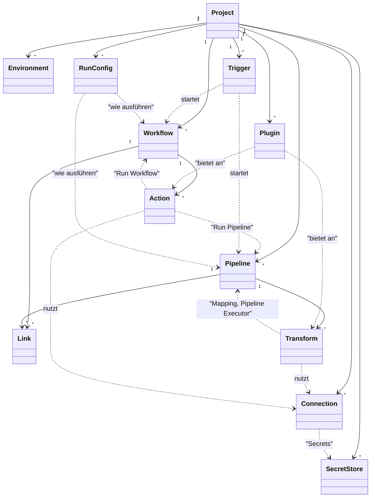
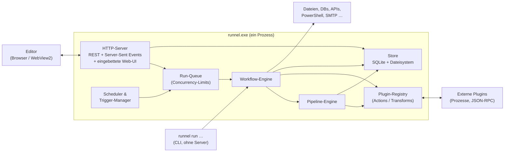
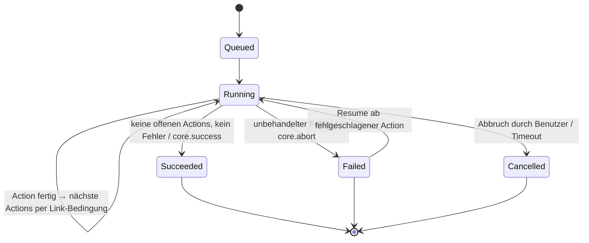
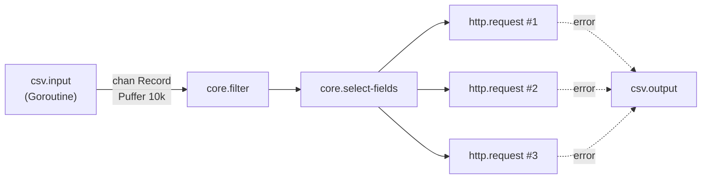

# Runnel – Konzept & technische Architektur

> Leichtgewichtige Workflow- und Datenintegrations-Plattform für Windows.
> Eine einzige ausführbare Datei, kein Docker, keine Java-/Node-Runtime, keine externe Datenbank.

Status: Entwurf v0.1 · Stand: 2026-11-21 (nach Phase 0.5)

---

## 1. Ziele & Abgrenzung

### 1.1 Vision

Runnel verbindet die **visuelle Einfachheit von n8n/Make** mit dem **sauberen Modell von Apache Hop**
(Workflows für Ablaufsteuerung, Pipelines für Datenströme) – betrieben als **eine schlanke Windows-Anwendung**,
die man per Doppelklick startet oder als Windows-Dienst installiert.

### 1.2 Kernziele

| Ziel | Messbares Kriterium |
|---|---|
| Kein Overhead | Eine `runnel.exe` (< 40 MB), keine Abhängigkeiten, Start < 1 s, < 60 MB RAM im Leerlauf |
| Windows-first | Läuft als Dienst, nutzt DPAPI für Secrets, PowerShell-Integration, Pfade/Freigaben (UNC) |
| Zwei Komponenten | **Editor** (Designen) und **Runner** (Ausführen) – getrennt nutzbar, gleiche Dateiformate |
| Git-freundlich | Workflows/Pipelines als lesbare YAML-Dateien, diff- und reviewbar |
| Erweiterbar | Plugins in beliebiger Sprache (Prozess-Protokoll) oder als JavaScript |
| Headless betreibbar | Runner per CLI ohne UI ausführbar (CI, Aufgabenplanung, Server) |

### 1.3 Nicht-Ziele (v1)

- Kein Multi-Tenant-SaaS, **keine Benutzer-/Rollenverwaltung** (wie bei Apache Hop; s. [ADR 0005](adr/0005-mehrbenutzerbetrieb.md))
- Kein Cluster / verteilte Ausführung (Remote-Runner erst in späterer Phase, s. Roadmap)
- Kein Big-Data-Backend (kein Spark/Beam/Flink wie bei Apache Hop) – Fokus auf Datenmengen bis ca. einige Mio. Zeilen pro Lauf
- Keine 400+ SaaS-Konnektoren wie Make/n8n – stattdessen starke generische Bausteine (HTTP, SQL, Dateien, Skript) plus Plugin-Modell

### 1.4 Positionierung

| | n8n | Make | Apache Hop | **Runnel** |
|---|---|---|---|---|
| Runtime | Node.js (+DB) | Cloud | Java (JVM) | **Native Binary** |
| Betrieb Windows | möglich, aufwendig | – (SaaS) | möglich, schwergewichtig | **Doppelklick / Dienst** |
| Modell | Item-basierter Graph | Szenario | Workflow + Pipeline | **Workflow + Pipeline** |
| Datenstrom/ETL | eingeschränkt | eingeschränkt | stark | **mittel–stark** |
| Speicherformat | DB (JSON export) | Cloud | XML-Dateien | **YAML-Dateien** |
| Footprint | ~300 MB+ | – | ~500 MB+ | **~40 MB** |

---

## 2. Fachliches Modell (Konzepte)

Das Modell (Workflow/Pipeline) lehnt sich an Apache Hop an; die Begriffe sind bewusst allgemein gehalten – Verbindungen heißen **Links** ([ADR 0009](adr/0009-begriff-link.md)).



### 2.1 Project

Ein Ordner im Dateisystem – die Einheit für Versionierung (Git), Deployment und Berechtigungen.

```
my-project/
├─ project.yaml              # Name, Version, Default-Environment
├─ environments/
│   ├─ dev.yaml              # Variablen je Umgebung
│   └─ prod.yaml
├─ connections/
│   └─ erp-sql.yaml          # DB-/HTTP-/SMTP-/SFTP-Verbindungen (ohne Klartext-Secrets, ADR 0022)
├─ secret-stores/
│   └─ company-vault.yaml    # Secret-Quellen, z. B. ein Tresor (ohne Werte, ADR 0022)
├─ triggers/
│   └─ nightly-import.yaml   # Cron, HTTP, Datei-Überwachung, Intervall
├─ run-configs/
│   └─ local-fast.yaml       # Wie wird ausgeführt (Puffer, Logging, Sampling …)
├─ workflows/
│   └─ nightly-import.workflow.yaml
├─ pipelines/
│   └─ customers-to-crm.pipeline.yaml
├─ plugins/
│   └─ sap-rfc/               # plugin.yaml + ausführbare Datei (ADR 0019)
└─ scripts/                  # gemeinsam genutzte JS-/PowerShell-Skripte
```

### 2.2 Workflow (Ablaufsteuerung)

- Ein **gerichteter Graph aus Actions**, verbunden durch **Links**.
- Actions laufen **sequenziell entlang der Links** (optional parallel verzweigt).
- Jede Action liefert ein **Result**: `success | failure` plus Ergebnisdaten (Variablen, Dateiliste, Zeilenanzahl, Exit-Code …).
- Links tragen eine **Bedingung**:
  - `success` (grün) – nur wenn Vorgänger erfolgreich
  - `failure` (rot) – nur wenn Vorgänger fehlgeschlagen
  - `always` (schwarz) – unabhängig vom Ergebnis
  - `expression` (blau) – frei formulierte Bedingung, z. B. `{{ result.rows > 0 }}`
- Typische Actions: Start, Pipeline ausführen, Sub-Workflow ausführen, PowerShell, HTTP, Datei-Operationen, Mail, Warten, SQL ausführen, Erfolg/Abbruch.
- Schleifen sind erlaubt, aber nur explizit (Link zurück mit Bedingung oder „Loop“-Action) und durch `maxIterations` begrenzt.

### 2.3 Pipeline (Datenfluss)

- Ein **gerichteter, azyklischer Graph aus Transforms**.
- **Alle Transforms laufen gleichzeitig** (wie in Apache Hop) und reichen **Records** über Links (gepufferte Kanäle) weiter → Streaming, konstanter Speicherverbrauch.
- Ein Record ist ein **geordnetes, JSON-artiges Objekt** (Feldname → Wert). Pipelines sind **schemalos mit optionalen Typen** (string, int, decimal, float, bool, date, datetime, binary, json) – Details: [ADR 0007](adr/0007-typsystem-pipelines.md).
- Links in Pipelines:
  - Normaler **Daten-Link**
  - **Fehler-Link**: fehlerhafte Records werden mit Fehlerinfos (`_error`, `_errorField`, `_errorTransform`) umgeleitet statt die Pipeline abzubrechen
  - **Info-Link**: Nebeneingang (z. B. Lookup-Daten für „Stream Lookup“, seit S23b1), wird vor den Daten-Links vollständig gelesen
- Verteilungsmodus bei mehreren Ausgängen: `copy` (jeder Ausgang bekommt jeden Record) oder `distribute` (Round-Robin), wie in Apache Hop.
- Transforms können mit **mehreren Kopien** (Parallelität) laufen, z. B. für teure HTTP-Lookups.

### 2.4 Link

Verbindung zwischen zwei Knoten. Im Workflow = Kontrollfluss mit Bedingung, in der Pipeline = Datenkanal.
Links können deaktiviert werden (bleiben im Design, werden nicht ausgeführt).

### 2.5 Environment & Variablen

- Variablen werden über Ebenen aufgelöst (spätere Ebene überschreibt):
  0. Eingebaut: `PROJECT_DIR` – absoluter Pfad des Projektordners ([ADR 0020](adr/0020-relative-pfade.md))
  1. Standardwerte der Workflow-Parameter (`parameters[].default`)
  2. Project (`project.yaml`, Abschnitt `variables`)
  3. Environment (`environments/<name>.yaml`; Auswahl per `--env`, sonst `defaultEnvironment` des Projekts)
  4. Beim Start übergebene Parameter (CLI `--param KEY=VALUE`, HTTP-Anfrage, Trigger, aufrufende Action)
  5. Zur Laufzeit gesetzte Variablen (Action „Set Variables“, ab S08)
- Syntax:
  - `${NAME}` – Variable aus den Ebenen oben (kompatibel zu Apache Hop); Werte dürfen selbst Variablen enthalten
    (z. B. `INBOX: ${BASE}\inbox`), Zyklen sind ein Fehler
  - `${env:NAME}` – Umgebungsvariable des Betriebssystems, z. B. `${env:COMPUTERNAME}`, `${env:TEMP}`
  - `${secret:NAME}` bzw. `${secret:QUELLE/NAME}` – Secret aus einer Secret-Quelle; Standardquelle je Environment
    (`secretStore:`), sonst der lokale Store. Nur in Connections, Secret-Quellen, Feldern mit `format: runnel-secret`
    und als Token von HTTP-Triggern erlaubt, nie über eine Variable ([ADR 0022](adr/0022-connections-secrets.md),
    Kap. 8). Seit S39a gibt es die Quelle `env` (Umgebungsvariablen, `secretStore: env`), seit S39a2 `inline` (Klartext unter
    `secrets:` im Environment, mit Warnung; für Entwicklung und einfache APIs); `local` folgt mit S39d
  - `$${` – ein wörtliches `${`
  - `{{ expression }}` – Ausdruck in [`expr-lang`](https://github.com/expr-lang/expr), z. B. `{{ formatDate(now(), 'yyyyMMdd') }}`, `{{ record.amount * 1.19 }}` – Details und Funktionsbibliothek: [ADR 0006](adr/0006-ausdruckssprache.md)
- Das Projekt wird über `project.yaml` im Ordner des Workflows oder einem übergeordneten Ordner gefunden (wie `.git`).
- **Relative Pfade** in allen Actions, Transforms und Triggern beziehen sich auf den Projektordner, ohne Projekt auf den
  Ordner der Workflow- bzw. Pipeline-Datei – nie auf das Arbeitsverzeichnis von Runnel
  ([ADR 0020](adr/0020-relative-pfade.md)).
- `runnel validate` meldet nicht definierte Variablen als Warnung – je Environment des Projekts, damit z. B. eine nur in
  `dev` gesetzte Variable für `prod` auffällt.

```yaml
# project.yaml
kind: Project
apiVersion: runnel/v1
name: my-project
defaultEnvironment: dev
variables:
  BASE: D:\data
  INBOX: ${BASE}\inbox
```

```yaml
# environments/prod.yaml – der Name muss dem Dateinamen entsprechen
kind: Environment
apiVersion: runnel/v1
name: prod
variables:
  BASE: \\fileserver\data
```

### 2.6 Connection & Credentials

Wiederverwendbare Metadaten-Objekte (DB, HTTP-API, SMTP, SFTP, KI-Anbieter, MCP-Server …), festgelegt in
[ADR 0022](adr/0022-connections-secrets.md):

```yaml
# connections/erp-sql.yaml
kind: Connection
apiVersion: runnel/v1
name: erp-sql                     # = Dateiname
type: sqlserver
with:
  host: ${ERP_HOST}               # Unterschiede je Environment über Variablen
  database: ERP
  user: runnel_read
  password: ${secret:erp-sql-password}
```

- `type` wählt die Art; ihre Felder beschreibt ein Schema (Prüfung bei `validate`, Formular im Editor).
- Bausteine nennen sie mit `connection: <name>`; `validate` prüft Existenz und passenden Typ.
- Secrets werden **nie im Klartext in YAML** gespeichert, sondern referenziert. Woher sie kommen, bestimmen
  **Secret-Quellen** (`secret-stores/*.yaml`, Standardquelle je Environment): der lokale, verschlüsselte Store
  (`local`, `shared`), Umgebungsvariablen (`env`) und später Tresore wie Azure Key Vault oder HashiCorp Vault (Kap. 8).
- SQL bekommt Werte nur als Parameter (`@name`), nie als Text im SQL; Dateitransfer läuft über den Namensraum
  `transfer` mit dem Protokoll in der Connection.

### 2.7 Trigger

| Typ | Beschreibung |
|---|---|
| `manual` | Start über UI oder CLI (kein Typ in Trigger-Dateien) |
| `cron` | Zeitplan (Cron-Syntax + Zeitzone), Option `overlap` (kein paralleler Lauf); Nachholen verpasster Läufe später (Backlog) |
| `http` | (seit S38a) HTTP-Endpunkt mit Methode und Pfad (`/api/customers/{id}`); Pfad, Query und Body werden zu Parametern. Als Webhook sofort `202` (`response: accepted`) oder als Dienst mit Antwort aus dem Lauf (`response: run`, Action bzw. Transform `http.response`) – [ADR 0018](adr/0018-http-trigger.md) |
| `file` | Ordner-Überwachung (Ordner + Pattern), z. B. neue CSV im Eingangsordner: ein Lauf je neuer Datei oder einer für alle neuen Dateien; der Ordner wird abgefragt (Polling), damit Netzlaufwerke und UNC-Pfade gleich funktionieren |
| `interval` | fester Abstand, z. B. alle 15 Minuten; der erste Lauf nach dem ersten Abstand |

Trigger können sowohl Workflows als auch Pipelines direkt starten.

### 2.8 Ausführungsvarianten

Details: [ADR 0008](adr/0008-ausfuehrungsvarianten.md).

| Variante | Umsetzung |
|---|---|
| Workflow oder einzelne Pipeline direkt ausführen | CLI, Editor, API, Trigger |
| **Run-Konfiguration** (wie wird ausgeführt; S42, Backlog) | Metadaten-Objekt `RunConfig` (`local`, später `remote`): Puffergrößen, Parallelität, Sampling, Log-Level, Timeout. Auswahl per CLI, Editor, Trigger oder aufrufender Action |
| Dynamisches Ziel | `pipeline: "pipelines/import-${MANDANT}.pipeline.yaml"`, immer im Projektordner, optional eingeschränkt über `allowedTargets` (seit S25b) |
| Ausführung pro Datensatz (Pipeline) | `core.pipeline-executor`, `core.workflow-executor` – pro Datensatz, pro Gruppe fester Größe oder pro Feldwechsel (`groupBy`), höchstens `copies` Läufe gleichzeitig; Ausgänge wie bei `core.switch`: `results` (ein Datensatz je Lauf), `rows` (Datensätze aus `core.to-result`), alle übrigen Daten-Links die Eingangsdatensätze ([ADR 0021](adr/0021-unter-pipelines.md), geplant als S25c–e) |
| Ausführung pro Datensatz (Workflow) | `forEach` an jeder Action (seit S24b), optional `parallel`, z. B. an `core.run-pipeline` / `core.run-workflow` |
| Datensätze zwischen Pipelines weitergeben | `core.to-result` / `core.from-result` |
| Teilausführung | Editor: „Ab hier ausführen“, „Nur diese Action ausführen“, Pipeline-Vorschau bis Transform X |
| Mapping (wiederverwendbare Unter-Pipeline) | Transform `core.run-pipeline`: Datensätze strömen durch eine andere Pipeline ([ADR 0021](adr/0021-unter-pipelines.md), geplant als S56) |
| Später | Remote-Ausführung |

### 2.9 KI-Funktionen

Details: [ADR 0012](adr/0012-ki-faehigkeit.md).

| Baustein | Umsetzung |
|---|---|
| Sprachmodelle | Action `ai.chat`; Anbieter (Anthropic, OpenAI-kompatibel, Ollama lokal) als Connection, Schlüssel per `${secret:…}` |
| Agenten | Action `ai.agent`: Schleife Modell → Werkzeug → Modell innerhalb der Action; Werkzeuge per Positivliste (`with.tools`) |
| Werkzeug-Vertrag | Workflows mit typisierten `parameters` (`type`, `enum`, `description`) und `outputs` – gilt für Sub-Workflows, Agenten, MCP und HTTP-Trigger |
| MCP | Server: `runnel mcp` stellt Workflows als Tools bereit; Client: Action `mcp.call-tool`; MCP-Server als Plugin-Quelle |
| RAG | Pipelines mit `ai.chunk`, `ai.embed` und Vektor-Ausgabe (pgvector, Qdrant) |
| Leitplanken | Positivliste, Freigabe-Action `core.approval`, Protokollierung jedes Modell-/Werkzeugaufrufs, Maskierung von Secrets, Schritt-, Rate- und Kostenlimits |

---

## 3. Systemarchitektur

### 3.1 Überblick



### 3.2 Die zwei Kernkomponenten

**Runner / Executor** (`runnel run`, `runnel serve`)
- Lädt Workflow-/Pipeline-YAML, validiert, löst Variablen auf, führt aus.
- Funktioniert **vollständig ohne Editor und ohne Server** (`runnel run workflows/x.workflow.yaml --env prod`) – ideal für Windows-Aufgabenplanung oder CI.
- Im Server-Modus zusätzlich: Scheduler, Trigger, Ausführungshistorie, Live-Status.

**Editor**
- Web-Single-Page-App, **in die exe eingebettet** (`go:embed`) und unter `http://localhost:7300` erreichbar.
- Optional als Desktop-Fenster: `runnel desktop` öffnet die UI in einem **WebView2**-Fenster (in Windows 10/11 bereits vorhanden) – fühlt sich an wie eine native App, ohne Electron.
- Der Editor arbeitet direkt auf den Projektdateien (über die REST-API des lokalen Servers) → was man im Editor speichert, ist sofort per CLI ausführbar.

### 3.3 Betriebsmodi

| Modus | Befehl | Einsatz |
|---|---|---|
| Einmal-Ausführung | `runnel run <datei> [--env prod] [--param k=v]` (`--run-config` mit S42, Backlog) | Aufgabenplanung, CI, Skripte. Exit-Code: 0 erfolgreich, 1 fehlgeschlagen, 2 nicht gestartet, 130 abgebrochen |
| Server | `runnel serve [projektordner] [--port 7300] [--triggers 127.0.0.1:7301] [--stop-timeout]` | Editor + Scheduler + HTTP-Trigger (eigener Listener) |
| Desktop | `runnel desktop` (geplant) | Server + WebView2-Fenster (Einzelplatz) |
| Windows-Dienst | `runnel service install/start/stop/status/uninstall` (seit S41) | Dauerbetrieb auf Server |
| Validierung | `runnel validate <datei/ordner>` (Workflows, Pipelines, Trigger) | Lint/Prüfung in CI |
| Trigger anzeigen | `runnel triggers [projektordner]` | Trigger mit Zeitplan und nächstem Zeitpunkt |
| Katalog | `runnel catalog [typ]` | Actions und Transforms mit Schema |
| Schemas der Dateien | `runnel schema <art>` | JSON Schema von `project.yaml`, Environments und Triggern (seit S58), z. B. für VS Code mit `# yaml-language-server: $schema=…` |
| Secrets (geplant) | `runnel secret set/list/delete/missing/export/import [--service]` | Lokalen Secret-Store pflegen, fehlende Secrets finden (S39d/S39e, [ADR 0022](adr/0022-connections-secrets.md)) |
| Plugins (geplant) | `runnel plugins [trust\|untrust] [projektordner] [--service]` | Plugins anzeigen und für das Projekt freigeben (S49, [ADR 0019](adr/0019-plugin-protokoll.md), Nachtrag) |
| Portable (geplant) | `runnel.exe` + `runnel.portable` im Ordner | Alle Daten neben der exe, z. B. USB / Netzlaufwerk |

---

## 4. Technologie-Stack

### 4.1 Entscheidung: Go für Backend/Runner

| Kriterium | Go | .NET 9 (AOT) | Node/Electron | Rust |
|---|---|---|---|---|
| Single-Binary ohne Runtime | ✅ nativ | ✅ (AOT mit Einschränkungen bei Reflection) | ❌ | ✅ |
| Nebenläufigkeit für Pipelines | ✅ Goroutinen + Channels ideal | ✅ Channels/Tasks | ⚠️ Single-Thread | ✅ (komplexer) |
| Windows-Dienst | ✅ `x/sys/windows/svc` | ✅ | ⚠️ | ✅ |
| DB-Treiber ohne CGO | ✅ MSSQL, Postgres, Oracle, SQLite (MySQL: Treiber MPL-2.0, vorerst nicht, ADR 0022) | ✅ | ✅ | ⚠️ |
| Entwicklungsgeschwindigkeit | ✅ hoch | ✅ hoch | ✅ hoch | ⚠️ mittel |
| Cross-Compile Linux/macOS | ✅ trivial | ✅ | ⚠️ | ✅ |

**Entscheidung: Go** ([ADR 0002](adr/0002-go-backend.md)). Das Goroutine/Channel-Modell bildet Links in Pipelines 1:1 ab,
die Binary ist klein und ohne CGO cross-kompilierbar. .NET 9 wurde als Alternative betrachtet und verworfen.

### 4.2 Bibliotheken (Backend)

Eingesetzt (fest gepinnt in `go.mod`): `goccy/go-yaml`, `expr-lang/expr`, `shopspring/decimal`, `robfig/cron/v3`,
`spf13/cobra` (CLI), `golang.org/x/text` (Kodierungen) und `golang.org/x/sys` (Windows-Dienst, Ereignisanzeige). Die
übrigen Einträge sind geplant und kommen mit ihrem Roadmap-Schritt; die Lizenz jedes Treibers und jeder Bibliothek wird
im PR geprüft und in den `THIRD_PARTY_NOTICES` geführt (ADR 0004, ADR 0022).

| Zweck | Bibliothek |
|---|---|
| CLI | `spf13/cobra` |
| HTTP-Router | `net/http` (Go 1.22+ Routing) |
| Live-Events | Server-Sent Events mit `net/http` ([ADR 0016](adr/0016-live-events-sse.md)) |
| SQLite (Connections seit S20a, Run-Historie mit S26) | `modernc.org/sqlite` (pure Go, kein CGO, BSD-3) |
| YAML | `goccy/go-yaml` (Fehlermeldungen mit Zeilennummer, zeilengenaues Bearbeiten über den AST) |
| JSON Schema | eigenes Paket `internal/schema` (Schemas aus Konfigurations-Structs, ADR 0014); Validierung über Schemas bei Bedarf später |
| Ausdrücke | `expr-lang/expr` (kompiliert, schnell, ohne Seiteneffekte) |
| Skript-Bausteine | `dop251/goja` (JavaScript, eingebettet, sandboxbar) |
| Exakte Dezimalzahlen | `shopspring/decimal` |
| Cron | `robfig/cron/v3` |
| Dateiüberwachung | keine Bibliothek: Polling des Ordners (S38), damit Netzlaufwerke und UNC-Pfade gleich funktionieren |
| Windows-Dienst / DPAPI / EventLog | `golang.org/x/sys/windows`, `.../svc`, `.../svc/eventlog` |
| SQL Server (seit S20c) | `microsoft/go-mssqldb` (inkl. Windows-Authentifizierung) |
| PostgreSQL (seit S20c) | `jackc/pgx/v5` |
| Oracle | `sijms/go-ora` (pure Go) |
| ODBC (optional, Access, Legacy; auch MySQL/MariaDB bis auf Weiteres) | `alexbrainman/odbc` |
| Excel | Lesen mit eigenem Reader (`internal/xlsx`: `archive/zip`, `encoding/xml`, seit S67a), Schreiben mit `xuri/excelize/v2` (seit S67b) – [ADR 0024](adr/0024-excel-lesen-schreiben.md) |
| CSV | `encoding/csv`, Kodierungen mit `golang.org/x/text` (Windows-1252, UTF-16) |
| SFTP | `pkg/sftp` + `x/crypto/ssh` |
| FTP/FTPS | offen; Auswahl mit S57 (Lizenz MIT-kompatibel) |
| Mail | Go-Standardbibliothek (`net/smtp`, `mime`, seit S62a); OAuth2 (Client Credentials, `XOAUTH2`) für Office 365 seit S62b ohne Bibliothek (`internal/oauth`) |
| Logging | `log/slog` (strukturiert, JSON) |
| WebView2-Fenster | `jchv/go-webview2` oder Wails v2 |

### 4.3 Frontend (Editor)

| Zweck | Wahl |
|---|---|
| Framework | **React 19 + TypeScript**, Build mit **Vite** |
| Graph-Canvas | **React Flow (xyflow)** – Knoten, Links, Zoom; Auto-Layout mit `@dagrejs/dagre` (MIT; `elkjs` scheidet wegen EPL-2.0/GPL-3.0 aus) |
| Formulare | Automatisch aus JSON-Schema der Action/Transform generiert (`@rjsf/core` oder eigene schlanke Lösung) |
| Code-/Ausdruckseditor | **CodeMirror 6** (Autovervollständigung für Variablen, Felder, Funktionen; S35, Nachtrag in ADR 0006) |
| Zustand | `zustand` + Undo/Redo-Stack (Command-Pattern) |
| Datenvorschau | Einfache Tabelle (höchstens 1.000 Zeilen, S44); virtualisiert (`@tanstack/react-table` + `react-virtual`) erst bei Bedarf |
| UI-Kit | `shadcn/ui` + Tailwind (leicht, kein schweres Komponenten-Framework) |
| Gestaltung | Design Tokens aus [`design/tokens`](../design/README.md) (Farben, Schriften, Radien, hell/dunkel) – [ADR 0011](adr/0011-corporate-design.md) |

Ziel-Bundle: < 3 MB gzip, wird in die exe eingebettet. Schriften (Inter, JetBrains Mono) liegen lokal unter
`design/fonts/`. Weitere Bibliotheken der Tabelle werden erst mit dem Schritt aufgenommen, der sie braucht – mit
Begründung im PR. Entwicklung: [docs/dev/EDITOR.md](dev/EDITOR.md).

---

## 5. Dateiformate

YAML, menschenlesbar, stabil sortiert (minimale Git-Diffs). Layout-Informationen (Koordinaten) liegen im selben Dokument,
aber in einem eigenen `layout`-Block, damit Logik-Diffs nicht vom Verschieben eines Knotens überlagert werden.

### 5.1 Workflow

```yaml
# workflows/nightly-import.workflow.yaml
kind: Workflow
apiVersion: runnel/v1
name: nightly-import
description: Lädt Kunden aus dem ERP und überträgt sie ins CRM
parameters:
  - name: IMPORT_DATE
    default: "{{ formatDate(addDays(today(), -1), 'yyyy-MM-dd') }}"
settings:
  timeout: 2h
  maxConcurrentRuns: 1

actions:
  - id: start
    type: core.start

  - id: wait-file
    type: file.wait
    with:
      path: "${INBOX}\\customers_${IMPORT_DATE}.csv"
      maxWait: 30m

  - id: load
    type: core.run-pipeline
    with:
      pipeline: pipelines/customers-to-crm.pipeline.yaml
      params:
        FILE: "${INBOX}\\customers_${IMPORT_DATE}.csv"
    retry: { attempts: 3, backoff: 1m }

  - id: archive
    type: file.move
    with:
      source: "${INBOX}\\customers_${IMPORT_DATE}.csv"
      target: "${ARCHIVE}\\"

  - id: notify-error
    type: mail.send
    with:
      connection: smtp-office365
      to: "${ADMIN_MAIL}"
      subject: "Import fehlgeschlagen: {{ run.id }}"
      body: "{{ run.lastError }}"

  - id: abort
    type: core.abort

links:
  - { from: start,     to: wait-file }
  - { from: wait-file, to: load,         when: success }
  - { from: load,      to: archive,      when: success }
  - { from: wait-file, to: notify-error, when: failure }
  - { from: load,      to: notify-error, when: failure }
  - { from: notify-error, to: abort }

layout:                 # Pixel, linke obere Ecke des Knotens (Karte 176 × 52 px)
  start:        { x: 40,  y: 120 }
  wait-file:    { x: 280, y: 120 }
  load:         { x: 520, y: 120 }
  archive:      { x: 760, y: 120 }
  notify-error: { x: 520, y: 280 }
  abort:        { x: 760, y: 280 }
```

Regeln des Workflow-Formats (umgesetzt in `internal/model`):

- Pflichtfelder: `kind: Workflow`, `apiVersion: runnel/v1`, `name`; je Action `id` und `type`; je Link `from` und `to`.
- Action-IDs: Buchstaben, Ziffern, `-` und `_`, beginnend mit einem Buchstaben. Action-Typen: `<namespace>.<name>`, z. B. `file.copy`.
- Parameternamen: Buchstaben, Ziffern und `_`, nicht mit einer Ziffer beginnend (für `${NAME}`).
- Parameter können einen Typ haben (`type`: `string` – Standard –, `integer`, `number`, `boolean`, `json`) und erlaubte
  Werte (`enum`); Standardwerte und beim Start übergebene Werte werden dagegen geprüft. Als Variable `${NAME}` bleibt der
  Wert Text.
- `outputs` (Name, optional Typ und Beschreibung, `value`) bilden das Ergebnis eines Workflows; sie werden nur bei
  erfolgreichem Ende ausgewertet. Parameter und Outputs sind der Werkzeug-Vertrag für Sub-Workflows, Agenten und MCP
  ([ADR 0012](adr/0012-ki-faehigkeit.md)).
- Link-Bedingung `when`: `success` (Standard, wenn nicht angegeben), `failure`, `always` oder ein Ausdruck `{{ … }}`.
- Zeitangaben: Go-Syntax mit Einheit, z. B. `30s`, `5m`, `2h`, `1h30m`.
- Unbekannte Felder sind ein Fehler (Schutz vor Tippfehlern); gemeldet werden alle auf einmal, nach Position sortiert,
  mit Vorschlag bei ähnlichem Namen (`unknown field "tpye" (did you mean "type"?)`). Fehler werden mit Datei, Zeile und Spalte gemeldet;
  alle Feldfehler einer Datei auf einmal.
- Eine Datei enthält genau ein YAML-Dokument.
- Graph (`runnel validate`): genau eine Action vom Typ `core.start` ohne eingehende Links; eindeutige Action-IDs;
  Links nur zwischen existierenden Actions; Zyklen nur über Links mit `loop: true`.
  Warnungen: vom Start aus unerreichbare Actions, doppelte Links, `loop: true` ohne Rücksprung,
  `joinTimeout` bei `join: first/each`, Layout-Einträge für unbekannte Actions.

### 5.2 Pipeline

```yaml
# pipelines/customers-to-crm.pipeline.yaml
kind: Pipeline
apiVersion: runnel/v1
name: customers-to-crm
parameters:
  - name: FILE
settings:
  bufferSize: 10000          # Records pro Link-Puffer (Backpressure)

transforms:
  - id: read
    type: csv.input
    with:
      path: "${FILE}"
      delimiter: ";"
      encoding: windows-1252
      header: true
      fields:
        - { name: kdnr,   type: int }
        - { name: name,   type: string }
        - { name: umsatz, type: decimal, format: "#.##0,00" }

  - id: only-active
    type: core.filter
    with:
      condition: "{{ record.umsatz > 0 }}"

  - id: map
    type: core.select-fields
    with:
      fields:
        - { name: kdnr, as: externalId }
        - { name: name, as: companyName }

  - id: stamp
    type: core.constant
    with:
      fields:
        - { name: importedAt, value: "{{ run.startedAt }}" }

  - id: to-crm
    type: http.request
    copies: 4                # 4 parallele Instanzen
    with:
      connection: crm-api
      method: POST
      url: /api/accounts
      body: "{{ record }}"

  - id: rejected
    type: csv.output
    with:
      path: "${ARCHIVE}\\rejected_${IMPORT_DATE}.csv"

links:
  - { from: read,        to: only-active }
  - { from: only-active, to: map }
  - { from: map,         to: stamp }
  - { from: stamp,       to: to-crm }
  - { from: to-crm,      to: rejected, type: error }
```

Regeln des Pipeline-Formats (umgesetzt in `internal/model`, Stand S12; das Beispiel oben zeigt den Zielumfang):

- Pflichtfelder: `kind: Pipeline`, `apiVersion: runnel/v1`, `name`; je Transform `id` und `type`; je Link `from` und `to`.
  Dazu `description`, `parameters` (wie bei Workflows, ohne `outputs`) und je Transform `with`.
- Transform-IDs wie Action-IDs; Typen `<namespace>.<name>` in einem eigenen Namensraum ([ADR 0013](adr/0013-typnamen-namensraeume.md)).
  Ob ein Typ existiert und seine Konfiguration passt, prüfen `runnel validate` und der Start eines Laufs (seit S13b).
- Links sind Daten-Links (`type: data`, Standard). **Fehler werden nur über Links behandelt** (`type: error`, seit S17a),
  nicht über ein Feld am Transform – wie die Fehlerpfade (`when: failure`) bei Workflows. Ein Datensatz, den ein
  Transform nicht verarbeiten kann, geht mit `_error` (Meldung), `_errorField` (Feld, sonst leer) und `_errorTransform`
  (ID) über alle Fehler-Links des Transforms (ab dem zweiten als Kopie); ohne Fehler-Link bricht die Pipeline ab. Der
  Datensatz ist der eingehende, unverändert (bei `csv.input` die Werte der Zeile als Text). Fehler-Links nutzen
  `csv.input`, `csv.output`, `core.convert` und `core.filter`; an anderen Transforms warnt `runnel validate`, dass der
  Link nie genutzt wird. Das Schema eines Fehler-Links ist das eingehende mit den drei Feldern. Info-Links (`type: info`,
  seit S23b1) bringen Nachschlagedaten zu Transforms, die sie annehmen (`core.stream-lookup`): je einer, Pflicht; der
  Transform liest sie vollständig, bevor er seine Daten-Links liest. Sie dürfen nicht aus demselben Transform stammen
  wie die Daten-Links (auch nicht weiter vorn), sonst würde die Pipeline blockieren – `runnel validate` meldet das.
- Graph: mindestens ein Transform, eindeutige IDs, Links nur zwischen vorhandenen Transforms, keine Links auf sich
  selbst und **keine Zyklen** (Datensätze fließen nur vorwärts). Warnungen: doppelte Links, Transforms ohne Verbindung.
- Je Transform `copies: n` (1–64 parallele Instanzen, die sich die eingehenden Datensätze teilen; nur für Transforms,
  die jeden Datensatz für sich verarbeiten – nicht für Ein- und Ausgaben) und `distribution: copy | distribute` (seit
  S17c). `settings:` der Pipeline: `batchSize` (Standard 500), `bufferSize` (Datensätze je Link, Standard 10.000,
  mindestens `batchSize`) und `strict` (ADR 0007). `layout` (Koordinaten je Transform-ID für den Editor) gibt es
  seit S25a1a; `disabled` ist noch ein unbekanntes Feld.
- `runnel validate` prüft `*.pipeline.yaml` mit; `runnel run` führt Pipelines aus und zeigt am Ende je Transform, wie viele
  Records er gelesen und geschrieben hat (seit S13b).

### 5.3 Trigger

```yaml
kind: Trigger
apiVersion: runnel/v1
name: nightly-import
type: cron
target: workflows/nightly-import.workflow.yaml   # relativ zum Projekt; auch Pipelines möglich
environment: prod          # leer: Standard-Environment des Projekts
params:                    # Werte für die Parameter des Ziels (fest oder ${…})
  DAYS: 3
enabled: true              # false: bleibt im Projekt, startet aber nichts
with:
  schedule: "0 2 * * 1-5"  # Minute Stunde Tag Monat Wochentag, oder @daily, @hourly …
  timezone: Europe/Berlin  # leer: Zeitzone des Rechners
  overlap: skip            # skip (Standard) | allow
```

Trigger-Dateien liegen unter `triggers/` (`*.yaml`, auch in Unterordnern wie `triggers/nightly/`; versteckte Ordner `.…` zählen nicht); ihre Namen sind im ganzen Projekt eindeutig. Gestartet wird nur, solange `runnel serve` läuft; geänderte Dateien
übernimmt der Server ohne Neustart. Verpasste Zeitpunkte (Server lief nicht) werden nicht nachgeholt. `runnel triggers`
listet die Trigger mit ihrem nächsten Zeitpunkt, `runnel validate` prüft sie (Zeitplan, Ziel, Environment, Parameter).
`overlap: skip` startet keinen Lauf, solange der vorige dieses Triggers läuft. Felder unter `with:`, die der Typ nicht
kennt (z. B. `schedule` bei `interval`), sind ein Fehler. `runConfig` (S42), `overlap: queue` und das Nachholen
verpasster Läufe stehen im Backlog.

Intervall (seit S38) – der erste Lauf kommt einen Abstand nach dem Start des Servers, danach je ein Abstand nach dem
fälligen Zeitpunkt; ein unveränderter Trigger behält beim Neuladen seinen nächsten Zeitpunkt:

```yaml
type: interval
with:
  every: 15m               # mindestens 1s
  overlap: skip
```

Datei-Überwachung (seit S38):

```yaml
type: file
target: workflows/import.workflow.yaml
with:
  path: inbox              # Ordner: relativ zum Projekt oder absolut, auch \\server\freigabe\eingang
  pattern: "orders-*.csv"  # Dateiname, Groß-/Kleinschreibung egal; Standard *
  interval: 10s            # Abstand der Abfragen; Standard 10s, mindestens 1s
  param: FILE              # Parameter des Ziels, der den Pfad bekommt
  mode: each               # each (Standard): ein Lauf je Datei | batch: ein Lauf für alle neuen Dateien
  existing: process        # process (Standard): beim Start vorhandene Dateien verarbeiten | ignore
  overlap: skip
```

- Der Ordner wird im Abstand `interval` gelesen (Polling, keine Benachrichtigungen des Dateisystems): Das funktioniert
  auf Netzlaufwerken und UNC-Pfaden gleich, kostet aber je Abfrage ein Lesen des Ordners. Unterordner werden nicht
  durchsucht.
- **Neu** ist eine Datei, die vorher nicht da war oder sich seit dem Start ihres Laufs geändert hat (Größe oder
  Änderungszeit). **Bereit** ist sie, wenn sie bei zwei Abfragen nacheinander unverändert ist – so wird eine Datei, die
  noch geschrieben wird, nicht halb verarbeitet. Eine neue Datei wird also frühestens nach `interval` gestartet.
- **Verarbeitet** ist eine Datei, sobald ihr Lauf gestartet wurde – nicht erst, wenn er erfolgreich war. Das Verschieben
  oder Löschen der Datei ist Sache des Workflows (z. B. `file.move` ins Archiv). Wird der Start übersprungen
  (`overlap: skip`) oder abgelehnt (`settings.maxConcurrentRuns`), bleibt die Datei neu und wird bei der nächsten
  Abfrage erneut versucht; die Meldung dazu steht nur einmal im Log.
- `mode: each` gibt den absoluten Pfad an den Parameter `param` (Typ `string`). Mit `overlap: skip` läuft immer nur ein
  Lauf: Die übrigen bereiten Dateien folgen nacheinander, je eine pro Abfrage. Für viele Dateien eignet sich
  `overlap: allow` (begrenzt durch `settings.maxConcurrentRuns`) oder `mode: batch`.
- `mode: batch` gibt die Pfade aller bereiten Dateien einer Abfrage als JSON-Liste an `param` (Typ `json`), z. B. für
  `forEach: "{{ params.FILES }}"`.
- Welche Dateien verarbeitet sind, weiß nur der laufende Server: Nach einem Neustart gilt `existing` erneut.

Ziel-Parameter prüft `runnel validate`: `param` muss das Ziel deklarieren (`string` bzw. `json`, ohne `enum`) und darf
nicht zusätzlich unter `params` stehen. Ein Trigger startet Workflows und Pipelines gleich; Pipelines bekommen den Pfad
ebenso als Parameter (z. B. für `csv.input`).

HTTP-Trigger (seit S38a; Grundlage [ADR 0018](adr/0018-http-trigger.md)) – ein Aufruf startet einen Lauf:

```yaml
type: http
target: workflows/import.workflow.yaml
params: { MODE: full }       # feste Werte; die Anfrage kann sie nicht ändern
with:
  method: POST               # GET, POST, PUT, PATCH, DELETE
  path: /hooks/import/{DAYS} # Platzhalter {name} werden zu Parametern des Ziels
  auth: { token: ${env:IMPORT_TOKEN} }   # oder: auth: none
  response: accepted         # sofort 202 mit der Lauf-ID; run: Antwort aus dem Lauf (seit S38b1)
  timeout: 30s               # nur bei run: so lange wartet der Aufrufer höchstens (Standard 30s)
  maxConcurrent: 5           # laufende Runs dieses Triggers, darüber 429; 0 (Standard): kein eigenes Limit
  history: all               # all | errors | none – welche Läufe behalten werden (seit S38b2)
```

- **Listener:** HTTP-Trigger laufen auf einem eigenen Listener, getrennt vom Editor: `--triggers` bei `runnel serve`
  und `runnel service install`, Standard `127.0.0.1:7301`. Er öffnet sich erst, wenn ein HTTP-Trigger aktiv ist.
  Anfragen aus Webseiten (`Origin`-Header) werden mit `403` abgelehnt, bei einem lokalen Listener auch Anfragen an
  fremde Host-Namen (DNS-Rebinding).
- **Im Netz (seit S40a):** z. B. `--triggers 0.0.0.0:7301` – dann nur mit HTTPS:
  - `--triggers-tls auto`: selbst erzeugtes Zertifikat (ECDSA P-256, 2 Jahre, für `localhost`, den Rechnernamen und
    die IP-Adressen des Rechners). Es wird einmal erzeugt und wiederverwendet, 30 Tage vor Ablauf oder nach einer
    Umbenennung des Rechners neu erzeugt. Ablage: beim Dienst `%ProgramData%\runnel\tls\` (nur für Dienstkonto,
    Administratoren und SYSTEM lesbar), sonst `%LOCALAPPDATA%\runnel\tls\`, nie im Projekt. Das Log nennt Namen,
    Ablauf und SHA-256-Fingerabdruck; Aufrufer vertrauen ihm, indem sie `triggers.crt` importieren.
  - `--triggers-cert` und `--triggers-key`: eigenes Zertifikat als PEM-Dateien (z. B. von der Firmen-CA); ein
    erneuertes Zertifikat wird ohne Neustart übernommen (Prüfung höchstens jede Minute).
  - Reines HTTP im Netz nur mit `--triggers-insecure` (Warnung im Log bei jedem Start), denn Tokens und Daten gingen
    im Klartext. Für Trigger mit `auth: none` warnt das Log ebenfalls, wenn der Listener im Netz lauscht.
- **Routing:** Methode und Pfad sind im Projekt eindeutig; feste Teile ohne Rücksicht auf Groß-/Kleinschreibung.
  Überschneidungen (`/a/{x}` und `/a/b`) meldet `runnel validate`, der spätere Trigger bleibt inaktiv. Unbekannter
  Pfad oder deaktivierter Trigger: `404`, falsche Methode: `405`.
- **Absicherung:** `auth: { token: ${env:NAME} }` erwartet `Authorization: Bearer <token>` (sonst `401`). Das Token steht
  nur in einer Umgebungsvariablen, nie in der Datei; fehlt sie beim Laden, ist der Trigger inaktiv. `auth: none` ist
  ausdrücklich anzugeben.
- **Parameter:** Pfad-Platzhalter, Query und Body (JSON-Objekt oder Formular `application/x-www-form-urlencoded`) werden
  zu Parametern des Ziels; bei gleichem Namen gilt Pfad vor Query vor Body. Nicht deklarierte Felder werden ignoriert,
  feste `params` des Triggers gewinnen. JSON-Werte, die kein Text sind, kommen als JSON-Text an (für Parameter vom Typ
  `json`). Fehlt ein Pflichtparameter oder passt ein Typ nicht: `400` mit der Meldung, ohne Lauf. Andere Formate:
  `415`, Body über 1 MiB: `413`.
- **Antwort bei `accepted`:** `202` mit `{ "runId": …, "status": "/api/v1/runs/…" }` (der Status steht in der API des
  Editors).
- **Antwort bei `run` (seit S38b1):** Der Aufrufer wartet auf den Lauf, höchstens `timeout`.
  - Die erste ausgeführte Action **`http.response`** antwortet (`status`, `headers`, `body` mit Ausdrücken; ein Text geht
    als Text, andere Werte als JSON); spätere schreiben eine Warnung ins Log. Der Workflow arbeitet nach der Antwort
    weiter. Auch eine `http.response` in einem aufgerufenen Workflow (`core.run-workflow`) antwortet. Ohne wartenden
    Aufrufer (Editor, `runnel run`, andere Trigger) tut sie nichts.
  - Ohne `http.response`: Endet der Lauf erfolgreich, sind die `outputs` als JSON-Objekt die Antwort (`200`; bei einer
    Pipeline die Zähler der Transforms); scheitert er, `500` mit der Lauf-ID, ohne Details (die stehen im Log).
  - **Pipelines (seit S38c):** Der Transform **`http.response`** antwortet mit den Datensätzen, die er erhält, als
    JSON – eine Liste, mit `single: true` der erste Datensatz als Objekt (ohne Datensätze `null`). Felder in ihrer
    Reihenfolge, Dezimalzahlen als Zahl, Datum als `yyyy-mm-dd`; höchstens `maxRecords` (Standard 10.000) im Speicher.
    Er antwortet, wenn seine Eingabe endet und er Datensätze erhalten hat; der erste gilt. Mit **`whenEmpty: true`**
    ist er die Rückfallantwort: Sie geht – mit oder ohne Datensätze – erst am Ende des Laufs hinaus und nur, wenn kein
    anderer `http.response` geantwortet hat. So entsteht z. B. „Kunde gefunden → `200`, sonst `404`“ mit zwei
    `http.response` hinter demselben Filter (`examples/pipelines/pipelines/customer-api.pipeline.yaml`). Die Datensätze
    gehen weiter; ohne wartenden Aufrufer tut er nichts.
  - **Datensätze aus dem Body (seit S38c):** Ist das Ziel eine Pipeline, darf der Body eine JSON-Liste von Objekten
    sein; sie kommt wie `rows` bei `core.run-pipeline` als Datensätze an (`core.from-result`, Felder nach Namen
    sortiert). Parameter kommen dann aus Pfad und Query.
  - Kommt bis `timeout` keine Antwort: `504`; der Lauf läuft weiter.
- **Historie und Last (seit S38b2):**
  - `history` bestimmt, welche Läufe nach dem Ende behalten werden: `all`, `errors` (nur gescheiterte) oder `none`
    (keine; der Lauf erzeugt auch keine Ereignisse für den Editor). Standard: `all` bei `accepted`, `errors` bei `run`.
  - Läufe von HTTP-Triggern haben im Lauf-Speicher ein eigenes Limit (die letzten 100), damit viele Anfragen die Läufe
    aus Editor und Zeitplänen nicht verdrängen.
  - Geprüfte Workflows und Pipelines (nach Inhalt der Datei), das Projekt (nach Stand von `project.yaml` und
    `environments/`) und übersetzte Ausdrücke werden zwischengespeichert; eine geänderte Datei wird beim nächsten Start
    neu geprüft. Aufgerufene Workflows werden beim Aufruf geprüft. Richtwert: ein kleiner Workflow mit Antwort braucht
    etwa 0,23 ms je Anfrage auf einem Kern, parallel auf vier Kernen etwa 0,08 ms
    (`go test ./internal/server -run XXX -bench HTTPTrigger`).
  - Bei `response: run` trägt jede Antwort den Header `Runnel-Run-Id`.
- **`request` in Ausdrücken (seit S38b1):** `request.method`, `.path`, `.headers`, `.query`, `.body` (JSON-Wert oder
  Felder des Formulars) und `.client`; ohne HTTP-Aufrufer ist `request` leer (`nil`), z. B.
  `{{ request?.body?.name ?? 'none' }}`. Der Header `Authorization` steht nicht darin. Aufgerufene Workflows sehen
  denselben `request`.
  `maxConcurrent` oder `settings.maxConcurrentRuns` erreicht: `429`; Server wird beendet: `503`. Der Lauf trägt
  `trigger = http:<name>` und die Adresse des Aufrufers (`client`).

---

## 6. Ausführungs-Engine

### 6.1 Workflow-Engine



Ablauf:
1. **Laden & Validieren**: YAML parsen, gegen JSON-Schema prüfen, Action-Typen in der Registry auflösen, Graph prüfen (Start vorhanden, keine unerreichbaren Knoten, Zyklen nur mit Limit).
2. **Kontext aufbauen**: Variablen-Scopes, Credentials (lazy entschlüsselt), Logger, `context.Context` für Abbruch/Timeout.
3. **Ausführen**: Ab `start` werden Actions in eine Ready-Queue gelegt. Jede Action läuft in einer Goroutine; nach Abschluss werden die ausgehenden Links ausgewertet und Nachfolger „bereit“ gesetzt.
   - **Parallelität**: Hat eine Action mehrere erfüllte ausgehende Links, laufen die Nachfolger parallel.
   - **Fehler in einem Zweig**: Die anderen Zweige laufen zu Ende; ein von keinem Link behandelter Fehler lässt den Workflow danach fehlschlagen. `core.success`/`core.abort` beenden sofort und brechen laufende Zweige ab.
   - **Join**: Konfigurierbar pro Action (`join: all | first | each`), Projektstandard `all`: Eine Action mit mehreren eingehenden Links startet einmal, sobald alle Vorgänger fertig sind, die noch ein Signal liefern können (Dead-Path-Elimination; nicht durchlaufene Actions erhalten den Status `skipped`). Details: [ADR 0003](adr/0003-join-semantik.md).
4. **Fehlerbehandlung je Action**: `retry` (`attempts` = Versuche insgesamt, `backoff` = Wartezeit vor dem zweiten Versuch, `strategy: fixed|exponential`), `timeout` (gilt je Versuch), `continueOnError`. `settings.timeout` begrenzt den ganzen Workflow; ein Abbruch (Strg+C) stoppt laufende Actions, folgt keinen Fehler-Links und endet mit Status `cancelled`.
   **Ergebnis des Workflows:** `core.success` beendet ihn erfolgreich, `core.abort` als fehlgeschlagen (ohne Fehler-Links). Folgt auf eine Action kein Link mehr, entscheidet ihr Ergebnis: Ein Fehler, den kein Fehler- oder Immer-Link behandelt, lässt den Workflow fehlschlagen. Enthält der Workflow ein `core.success`, das im Lauf nicht erreicht wurde (z. B. wegen eines deaktivierten Links), endet er trotzdem erfolgreich, aber mit der Warnung `workflow ended without reaching its end action "…"` im Log. Eine Action darf höchstens 10.000-mal je Lauf ausgeführt werden (Schutz vor Endlosschleifen).
5. **Persistenz**: Jeder Statuswechsel wird in SQLite geschrieben (Run, ActionRun, Ergebnis, Dauer) → Live-Anzeige im Editor und **Resume** nach Absturz/Fehler ab der fehlgeschlagenen Action.

Schnittstelle einer Action (Go):

```go
type Action interface {
    // Wird beim Laden aufgerufen – Konfiguration prüfen, Defaults setzen.
    Init(cfg ActionConfig) error
    // Führt die Action aus. ctx wird bei Abbruch/Timeout gecancelt.
    Execute(ctx context.Context, ec *ExecContext) (Result, error)
}

type Result struct {
    Success   bool
    ExitCode  int
    Rows      int64
    Files     []string
    Variables map[string]any   // werden für Nachfolger sichtbar
    Output    any               // beliebiges JSON-Ergebnis
}
```

### 6.2 Pipeline-Engine



- Jeder Transform (bzw. jede Kopie) ist eine **Goroutine**, jeder Link ein **gepufferter Channel** von Record-Batches.
- **Batching**: Records werden intern in Batches (z. B. 500) übertragen, um Channel-Overhead zu minimieren; für den Transform-Entwickler unsichtbar.
- **Backpressure** entsteht automatisch: Volle Puffer blockieren den Erzeuger → konstanter Speicher auch bei großen Dateien.
- **Ende-Signal**: Schließen des Channels propagiert durch den Graphen; die Pipeline ist fertig, wenn alle Transforms beendet sind.
- **Fehler**: Pro Record → Fehler-Link (falls vorhanden), sonst Pipeline-Abbruch (alle Goroutinen via Context gecancelt). Die Zähler zeigen die Fehler je Transform (`read 4, written 3, errors 1`). Eine Schwelle (`maxErrors`) ist zurückgestellt (Backlog).
- **Metriken** je Transform: gelesen/geschrieben/Fehler/Records pro Sekunde/Puffer-Füllstand – live per Server-Sent Events im Editor (vergleichbar mit dem „Metrics“-Tab in Apache Hop).
- **Transaktionen**: DB-Outputs mit `commitSize`; optional „Unique Connection“-Modus (eine Transaktion über die ganze Pipeline, Rollback bei Fehler).

Schnittstelle eines Transforms (Go, umgesetzt mit S13a in `internal/transform`):

```go
type Transform interface {
    // Process liest die Batches von in, bis der Kanal geschlossen ist, und gibt Records
    // mit out.Emit weiter. Ein Fehler hält die ganze Pipeline an.
    Process(ctx context.Context, in <-chan Batch, out *Output) error
}

// Output: Emit(record) – blockiert bei vollen Puffern (Backpressure), meldet den Abbruch;
// Logf(level, …) – Meldung ins Lauf-Log.
```

- **Mehrere Eingänge** eines Transforms werden zu einem Strom gemischt (Reihenfolge zwischen den Zweigen nicht
  festgelegt); **mehrere Ausgänge** bekommen jeden Record (`copy`), ab dem zweiten als Kopie, damit Zweige sich nicht
  gegenseitig verändern. Mit `distribution: distribute` bekommen die Daten-Links die Records reihum (Fehler-Links
  und `EmitTo` bleiben davon unberührt).
- **Kopien** (`copies: n`): n Goroutinen mit je einer eigenen Instanz des Transforms lesen aus demselben Eingang und
  schreiben in dieselben Links; die Reihenfolge der Records ist danach nicht mehr festgelegt. Zähler und Ereignisse
  gelten für den Transform als Ganzes, Log-Meldungen schreibt jede Kopie selbst. Schlägt eine Kopie fehl, bricht die
  Pipeline ab. Erlaubt nur, wo die Definition es zulässt (`Parallel`).
- Batches zu 500 Records, Puffer je Link 10.000 Records; je Pipeline änderbar mit `settings.batchSize` und
  `settings.bufferSize` (S17c).
- Hört ein Transform vor dem Ende seiner Eingabe auf zu lesen, verwirft die Engine den Rest, damit die Transforms davor
  fertig werden. Eine Panik in einem Transform wird zum Fehler der Pipeline.
- **Zähler** je Transform: gelesen, geschrieben (Ereignis `transform.finished`, Ergebnis des Laufs).
- **Schema und Werttypen** (S14, ADR 0007 mit Nachtrag): Transforms können `Init(ic) → Schema` umsetzen; die Engine
  leitet die Schemas vor dem Lauf durch den Graphen ab, prüft verwendete Felder (`ic.Use`) und meldet Tippfehler mit
  Datei, Zeile und Spalte – als Fehler bei geschlossenem, als Warnung bei offenem Schema. `Process` bleibt unverändert;
  einfache Transforms wie `core.filter` (S16a) kommen mit einer Schleife in `Process` aus. Eigene Basistypen
  (`RowMapper`, `RowFilter`) werden erst eingeführt, wenn sich das Muster in mehreren Transforms wiederholt.
- **Ausdrücke je Datensatz** (S16a, ADR 0006): `record` und die Werte des Laufs (`vars`, `params`, `env`, `run`);
  Dezimalzahlen exakt, Rechnen mit `null` ergibt `null`, Größenvergleiche mit `null` sind `false`.

### 6.3 Datenvorschau & Debugging (Editor)

- **Preview**: Pipeline bis zu einem gewählten Transform mit `limit: 100` ausführen, Records je Link anzeigen (Tabelle + JSON).
- **Sampling im Lauf**: Bei jedem Lauf werden die ersten N Records pro Link gespeichert (abschaltbar) → nachträgliche Fehlersuche.
- **Breakpoints** (Phase 2): Pause bei Bedingung, z. B. `{{ record.kdnr == 4711 }}`.
- **Teilausführung im Workflow**: „Ab hier ausführen“ (optional mit Ergebnissen des letzten Laufs) und „Nur diese Action ausführen“ (s. [ADR 0008](adr/0008-ausfuehrungsvarianten.md)).

### 6.4 Run-Queue & Ressourcen

- Globales Limit gleichzeitiger Runs (`settings.maxConcurrentRuns` in `project.yaml`), zusätzlich pro Workflow
  (`settings.maxConcurrentRuns`). Seit S37 wird ein Start über dem Limit abgelehnt (Editor/API: `429`, Trigger: Meldung
  im Server-Log); eine Warteschlange, die ihn später startet, steht im Backlog.
- Prioritäten (manuell > HTTP-Trigger > zeitgesteuerte Trigger) – mit der Run-Queue (Backlog).
- Graceful Shutdown: Dienst-Stopp wartet konfigurierbar auf laufende Runs (`--stop-timeout`, beim Dienst Standard 30 s,
  bei `runnel serve` 0), startet in der Zeit keine neuen und bricht danach ab – Status `cancelled` (seit S41; Fortsetzen
  abgebrochener Runs folgt mit der Run-Historie).

---

## 7. Erweiterbarkeit (Plugins)

Drei Stufen – von einfach bis mächtig:

### 7.1 Stufe 1: Skript-Actions/-Transforms (JavaScript, eingebettet)

- Action `core.script` (Workflow) und Transform `core.script` (Pipeline) führen JS in **goja** aus. JavaScript gibt es nur hier; `{{ … }}`-Ausdrücke nutzen `expr-lang` ([ADR 0006](adr/0006-ausdruckssprache.md)).
- Sandbox: kein Dateisystem-/Netzwerkzugriff außer über bereitgestellte APIs (`http`, `fs` – per Projekteinstellung freischaltbar), CPU-Zeitlimit.
- Wiederverwendbare Skripte in `scripts/` werden über `require('./scripts/utils.js')` geladen.

### 7.2 Stufe 2: PowerShell / Shell

- Regeln für beide (ohne Shell, Timeout mit Prozessbaum, Grenzen, Secrets nur in `env`): [ADR 0023](adr/0023-programme-powershell.md); `shell.run` startet Programme mit einer Argumentliste (seit S60).
- `shell.powershell` (seit S61) mit Übergabe von Werten als benannte Parameter (`params`, mit Typen) und Rückgabe von JSON (`ConvertTo-Json`) als Action-Ergebnis; das Skript selbst enthält keine `${…}`/`{{ … }}`.
- Bevorzugt `pwsh.exe` (PowerShell 7), Fallback `powershell.exe` (5.1); wählbar mit `edition`.
- In Pipelines: Transform `shell.powershell` – Records als NDJSON über stdin/stdout.

### 7.3 Stufe 3: Externe Plugins (beliebige Sprache)

Go-eigene Plugins (`plugin`-Paket) funktionieren unter Windows nicht – deshalb ein **prozessbasiertes Protokoll**
([ADR 0019](adr/0019-plugin-protokoll.md)); `hashicorp/go-plugin` wird bewusst nicht verwendet (Lizenz, Port unter
Windows, gRPC für andere Sprachen).

- Plugin = Ordner `plugins/<name>/` im Projekt mit `plugin.yaml` (`kind: Plugin`) und ausführbarer Datei; Plugins
  gibt es nur im Projekt.
- Jedes Plugin hat **einen eigenen Namensraum** (`namespace:`) und bietet nur Typen darin an; die Namensräume der
  eingebauten Bausteine sind reserviert ([ADR 0013](adr/0013-typnamen-namensraeume.md)). Welche Typen es anbietet,
  meldet es mit `describe`.
- Kommunikation: **JSON-RPC 2.0 über stdin/stdout** (eine Nachricht je Zeile), Logs über stderr; Handshake mit
  Protokollversion (`initialize`).
- Methoden:
  - `describe` → Descriptoren der Actions/Transforms inkl. JSON-Schema der Eigenschaften (Kap. 7.4)
  - `action.execute` → einmaliger Aufruf, `outputs` zurück
  - `transform.open` / `transform.batch` / `transform.end`, vom Plugin `transform.emit` / `transform.closed` →
    Streaming von Record-Batches; Feldkopf einmal, Records als Arrays, Flusssteuerung über Kredite (`$/ack`)
- **Ein Prozess je Plugin und Lauf**; unter Windows in einem Job Object, damit beim Abbruch auch Kindprozesse enden.
  Absturz eines Plugins lässt die Bausteine scheitern, nicht den Server.
- Plugins nutzen **keine Dienste des Hosts**: Variablen, Ausdrücke und Secrets löst der Host vorher in der `config` auf.
- **Freigabe je Projekt:** Ein Plugin startet erst, wenn es auf dem Rechner für das Projekt freigegeben ist
  (`runnel plugins trust`, Hash über den Plugin-Ordner, gespeichert außerhalb des Projekts). Ein fremdes Projekt führt
  so beim Prüfen oder Öffnen keinen Code aus ([ADR 0019](adr/0019-plugin-protokoll.md), Nachtrag).
- Weitere Ausgänge wie bei `core.switch` (Ziel-IDs in der `config`), optional `transform.init` für das Schema und
  `transform.detectFields`; Arbeitsverzeichnis des Plugins ist der Projektordner.
- SDKs: Go (Referenz, `pkg/sdk`), später Python, C#/.NET, Node – jeweils dünne Wrapper.

```yaml
# plugins/sap-rfc/plugin.yaml
kind: Plugin
apiVersion: runnel/v1
name: sap-rfc
version: 1.0.0
namespace: sap
executable: sap-rfc-plugin.exe
```

### 7.4 Registry & UI-Integration

Alle Bausteine (eingebaut, JS, extern) beschreiben sich über denselben **Descriptor**
([ADR 0014](adr/0014-action-descriptor-schema.md)):

```json
{
  "type": "http.request",
  "kind": "transform",
  "category": "network",
  "label": "HTTP Request",
  "description": "Sends an HTTP request for each record",
  "schema": { "$schema": "https://json-schema.org/draft/2020-12/schema", "type": "object", "properties": { "...": {} } },
  "example": "url: https://api.example.com/customers/{{ record.id }}",
  "recordErrors": true,
  "parallel": true
}
```

`type` bis `schema` gibt es seit E1 (`runnel catalog --json`); `example` (Hilfe im Panel, E14b), bei Transforms
`recordErrors` (Fehler-Link erlaubt), `parallel` (`copies` erlaubt) und `detectFields` (S46) sind optional. Es gibt
**keine Ports**: Pipeline-Links sind Daten- oder Fehler-Links, weitere Ausgänge nennen Felder mit
`format: runnel-target` (wie `to:` bei `core.switch`, [ADR 0021](adr/0021-unter-pipelines.md)). Eigene Icons von
Plugins kommen erst als SVG-Pfaddaten (höchstens 4 KB, ADR 0019 Nachtrag); bis dahin zeigt der Editor das allgemeine Symbol. Eingebaute Bausteine erzeugen `schema` aus ihrem Konfigurations-Struct (Tags `json`, `doc`,
`schema`), Plugins liefern es fertig mit.

Der Editor rendert Palette und Eigenschaftsdialog **vollständig aus dem Descriptor** – neue Plugins brauchen keinen Frontend-Code.

**Typnamen** haben die Form `<namensraum>.<name>`. Actions und Transforms haben getrennte Registries: Derselbe Name
kann als Action (in Workflows) und als Transform (in Pipelines) existieren, z. B. `http.request`. Ein Namensraum gehört
genau einem Anbieter – Runnel selbst, einem Plugin oder einer MCP-Connection (`mcp-<connection>`)
([ADR 0013](adr/0013-typnamen-namensraeume.md)).

---

## 8. Sicherheit

| Thema | Lösung |
|---|---|
| Netzwerk | Server bindet standardmäßig nur an `127.0.0.1` und nimmt nur Anfragen an `localhost`/`127.0.0.1` ohne fremden `Origin` an (Schutz vor DNS-Rebinding und Anfragen fremder Webseiten). Für Netzzugriff auf den Editor später `--listen 0.0.0.0:7300` + TLS (S40b, Backlog). HTTP-Trigger haben einen eigenen Listener, im Netz nur mit TLS (seit S40a) |
| Authentifizierung | **Keine Benutzerverwaltung** ([ADR 0005](adr/0005-mehrbenutzerbetrieb.md)). Lokal-Modus ohne Zugangsschutz; im Netzmodus (S40b) ein gemeinsamer Zugangsschlüssel für den Server (+ TLS), gleichzeitig nutzbar als API-Token. HTTP-Trigger: Token je Trigger oder `auth: none` (seit S38a) |
| Mehrere Browser | Ein Server, beliebig viele Editoren; Konfliktschutz per ETag, Live-Hinweis bei Änderungen anderswo, Zusammenarbeit über Git |
| Secrets | Über Secret-Quellen ([ADR 0022](adr/0022-connections-secrets.md)): lokaler Store je Projekt außerhalb des Projektordners, verschlüsselt mit AES-256-GCM, Schlüssel per **Windows DPAPI** (Benutzer- bzw. Dienstkonto), sonst `RUNNEL_MASTER_KEY` oder Master-Passwort; dazu Umgebungsvariablen und später Tresore. `${secret:…}` nur in Connections, Secret-Quellen und `secret`-Feldern; Pflege mit `runnel secret`, im Editor nur setzen, nie anzeigen |
| Secrets im Log | Automatische Maskierung aller aufgelösten Secret-Werte in Logs, Fehlermeldungen, Vorschauen und Ergebnissen (exakter Wert, ab 4 Zeichen) |
| HTTP-Trigger | Eigener Listener, getrennt vom Editor (Standard nur lokal; im Netz nur mit TLS – eigenes oder selbst erzeugtes Zertifikat – oder ausdrücklich `--triggers-insecure`, seit S40a); je Trigger ein Token (`Authorization: Bearer`) oder ausdrücklich `auth: none`, HMAC später; Body-Limit, `maxConcurrent` ([ADR 0018](adr/0018-http-trigger.md)) |
| Plugins | Start erst nach Freigabe je Projekt auf dem Rechner (`runnel plugins trust`, SHA-256 über den Plugin-Ordner, gespeichert außerhalb des Projekts; jede Änderung macht sie ungültig). Ohne Freigabe kein Code, auch nicht beim Prüfen oder Öffnen ([ADR 0019](adr/0019-plugin-protokoll.md), Nachtrag) |
| Datenbanken | Werte nur als Parameter (`@name`), Ausdrücke im SQL-Text sind ein Fehler; Bezeichner nur über geprüfte Felder; TLS mit Zertifikatsprüfung, Abschalten nur ausdrücklich mit Warnung ([ADR 0022](adr/0022-connections-secrets.md)) |
| Connections | Zugangsdaten einer HTTP-Connection nur an deren Host; SFTP nur mit bekanntem Hostschlüssel; FTP ohne TLS nur mit `insecure: true` und Warnung; „Test connection“ nur für gespeicherte Connections, 15 s |
| Skripte | JS-Sandbox mit Zeit-/Speicherlimit; Shell/PowerShell-Actions per Projekteinstellung deaktivierbar |
| Dienstkonto | Empfehlung: dedizierter Dienstbenutzer mit minimalen Rechten (bzw. gMSA in Domänen) |
| Audit | Dateiänderungen über den Editor, manuelle Starts und Abbrüche werden mit Client-Informationen (IP, Rechnername, User-Agent) protokolliert |

---

## 9. Persistenz & Logging

### 9.1 Was liegt wo?

| Daten | Ort | Format |
|---|---|---|
| Workflows, Pipelines, Trigger, Connections, Secret-Quellen, Plugins | Projektordner | YAML (Git); Plugins mit ausführbarer Datei |
| Run-Historie, Status, Metriken, Samples | `data\runnel.db` | SQLite (WAL-Modus) |
| Secrets (lokaler Store) | `%LOCALAPPDATA%\runnel\secrets.db` bzw. `%ProgramData%\runnel\secrets\` (Dienst), nie im Projekt (ADR 0022) | verschlüsselt |
| Run-Logs | `data\logs\<jahr>\<run-id>.log` | JSON-Lines (slog) |
| Dienst-Ereignisse | Windows-Ereignisanzeige (Anwendung) | Quelle = Dienstname (Standard `runnel`): Start, Stopp, Warnungen, Fehler (seit S41) |
| Server-Log des Dienstes | `%ProgramData%\runnel\logs\<dienst>.log` | Text, Rotation bei 10 MB nach `<dienst>.log.1` (seit S41) |
| Freigaben der Plugins | `<Konfigurationsordner>\runnel\trusted-plugins.json` (Benutzer) bzw. `%ProgramData%\runnel\trust\plugins.json` (Dienst, nur Administratoren), nie im Projekt (ADR 0019, Nachtrag) | JSON |
| Selbst erzeugtes Zertifikat der HTTP-Trigger | `%ProgramData%\runnel\tls\` (Dienst) bzw. `%LOCALAPPDATA%\runnel\tls\` | `triggers.crt`, `triggers.key` (PEM, seit S40a) |

Standardpfade: `%ProgramData%\runnel\` (Dienst) bzw. `%LOCALAPPDATA%\runnel\` (Desktop) bzw. neben der exe (portabel).

### 9.2 Datenmodell (SQLite, vereinfacht)

```sql
CREATE TABLE runs (
  id            TEXT PRIMARY KEY,          -- ULID (zeitlich sortierbar)
  kind          TEXT NOT NULL,             -- workflow | pipeline
  path          TEXT NOT NULL,             -- relativer Pfad im Projekt
  file_hash     TEXT NOT NULL,             -- Version der ausgeführten Definition
  environment   TEXT,
  trigger       TEXT,                      -- manual | cron:<name> | interval:<name> | file:<name> | http:<name> | cli
  parent_run_id TEXT REFERENCES runs(id),  -- Sub-Workflow, Pipeline aus Workflow, Mapping, Executor
  status        TEXT NOT NULL,             -- queued|running|succeeded|failed|cancelled
  params_json   TEXT,
  client_info   TEXT,                      -- IP/Rechnername bei manuellen Starts
  started_at    INTEGER, finished_at INTEGER,
  error         TEXT
);

CREATE TABLE node_runs (
  run_id     TEXT REFERENCES runs(id),
  node_id    TEXT,                         -- Action- oder Transform-ID
  attempt    INTEGER DEFAULT 1,
  status     TEXT,
  rows_in    INTEGER, rows_out INTEGER, rows_err INTEGER,
  result_json TEXT,
  started_at INTEGER, finished_at INTEGER,
  PRIMARY KEY (run_id, node_id, attempt)
);

CREATE TABLE samples (run_id TEXT, link TEXT, seq INTEGER, record_json TEXT);
```

Aufbewahrung: konfigurierbare Retention (z. B. 30 Tage Historie, 7 Tage Samples), Bereinigung durch internen Job.

### 9.3 Observability

- `/metrics` im Prometheus-Format (optional), `/health` für Monitoring (z. B. PRTG, Checkmk).
- Benachrichtigungen bei Fehlschlag: global konfigurierbarer „Error-Workflow“ (wie n8n), der bei jedem fehlgeschlagenen Run mit dessen Kontext gestartet wird.

---

## 10. API (Server-Modus)

REST unter `/api/v1`, JSON. Der Editor nutzt ausschließlich diese API – damit ist alles auch skriptbar.
Umgesetzte Endpunkte mit Statuscodes und Beispielen: [docs/dev/API.md](dev/API.md).

| Methode | Pfad | Zweck |
|---|---|---|
| GET | `/projects/current` · `/projects/current/tree` | Projekt (Name, Ordner) · Dateibaum des Projekts |
| GET/PUT/DELETE | `/files/{path}` | Workflow/Pipeline/Trigger lesen, speichern (mit ETag gegen Überschreiben) |
| POST | `/validate` | Definition prüfen (auch ungespeicherten Inhalt), Fehler mit Zeilen- und Knotenbezug (YAML-Pfad) |
| POST | `/workflows/edit` · `/pipelines/edit` | Änderung vom Canvas zeilengenau auf den YAML-Text anwenden (verschieben, löschen, anlegen, umbenennen, Links), Kommentare bleiben erhalten (seit E6a/E6b, Pipelines seit S25a) |
| GET | `/catalog` | Alle verfügbaren Actions/Transforms (Descriptors) |
| GET | `/schemas/{kind}` | JSON Schema einer Dateiart: `project`, `environment`, `trigger` (seit S58) |
| GET | `/variables` | Genutzte und definierte Variablen mit Fundstellen und Werten je Ebene (seit E18a) |
| GET | `/expressions` · `/version` | Wurzeln, Funktionen und Variablen für den Ausdruckseditor · Version des Servers |
| POST | `/runs` | Run starten `{ path, environment, params }`; später `runConfig`, `startAt`, `only`, `reuseResultsFrom` |
| GET | `/runs?status=&path=` | Historie (seit E3 im Speicher, Filter folgen mit S26 – zurückgestellt) |
| GET | `/runs/{id}` | Details inkl. Knotenstatus und Log |
| POST | `/runs/{id}/cancel` · `/runs/{id}/resume` | Steuern (`resume` mit S29, Backlog) |
| POST | `/preview` | Pipeline-Vorschau bis Transform X (S44, `docs/dev/API.md`) |
| GET | `/secrets` | Namen der Secrets mit Änderungszeit und Ablauf, nie Werte (geplant, S39g) |
| PUT/DELETE | `/secrets/{name}` | Secret setzen bzw. löschen, Wert nie lesbar zurück (geplant, S39g; im Netzbetrieb standardmäßig aus) |
| POST | `/connections/{name}/test` | Gespeicherte Connection für ein Environment testen, Zeitgrenze 15 s, Meldung ohne Secret-Werte (geplant, S39c) |
| GET | `/triggers` | Trigger mit nächstem Zeitpunkt, letztem Ergebnis und Problemen (seit S37); ein-/ausschalten über die Datei (`enabled`) |
| ANY | Pfade der HTTP-Trigger | auf dem eigenen Listener der Trigger, nicht unter `/api/v1` ([ADR 0018](adr/0018-http-trigger.md)) |
| GET | `/events?since=&run=` | Live-Events als Server-Sent Events ([ADR 0016](adr/0016-live-events-sse.md)): `run.started`, `run.finished`, `action.waiting`, `action.started`, `action.finished`, `action.skipped`, `log`, `reset`; später Metriken und `file.changed` |

---

## 11. Editor – UX-Konzept

Die Oberfläche ist englisch ([ADR 0015](adr/0015-sprache-oberflaeche.md)).

```
┌────────────────────────────────────────────────────────────────────────────────┐
│ Runnel      Project: my-project ▾   Env: dev ▾            ▶ Run  ⏸  ⟲  💾     │
├───────────────┬──────────────────────────────────────────────┬─────────────────┤
│ Explorer      │                                              │ Properties      │
│ ▸ workflows   │    (Start)──▶[Wait for file]──✔──▶[Pipeline] │ HTTP Request    │
│ ▸ pipelines   │                    │✖           │✔           │ URL: ________   │
│ ▸ triggers    │                    ▼            ▼            │ Method: POST ▾  │
│ ▸ connections │              [Send mail]    [Archive]        │ Body: {{ … }}   │
│───────────────│                                              │ Retry: 3        │
│ Palette 🔍    │                                              │                 │
│ ▸ General     │                                              │                 │
│ ▸ Files       │                                              │                 │
│ ▸ Database    │                                              │                 │
│ ▸ Network     │                                              │                 │
├───────────────┴──────────────────────────────────────────────┴─────────────────┤
│ Logs │ Metrics │ Preview │ Problems │ History                                    │
│ 14:02:11 load        ✔  12,430 rows   1.8 s                                     │
└────────────────────────────────────────────────────────────────────────────────┘
```

Kernfunktionen:
- Drag & Drop aus der Palette, Links per Ziehen zwischen Ports, Link-Typ per Klick umschalten (✔/✖/∞/ƒ)
- Live-Status auf dem Canvas (Knotenfarbe, Zeilenzähler an Links)
- Inline-Validierung (rote Markierung am Knoten und am Feld im Panel „Properties“ + Tab „Problems“)
- Feld-Autovervollständigung: Der Editor kennt das Ausgabeschema jedes Transforms (aus `Init`) und schlägt Feldnamen vor
- Copy/Paste von Knoten als YAML (zwischen Instanzen und in Tickets/Chats teilbar)
- Tastatur-Shortcuts, Undo/Redo, Auto-Layout, Gruppierung/Notizen auf dem Canvas
- Dateiänderungen von außen (z. B. `git pull`) werden per `file.changed` erkannt und neu geladen

---

## 12. Mitgelieferte Bausteine (Zielumfang)

Actions und Transforms haben getrennte Typ-Namensräume ([ADR 0013](adr/0013-typnamen-namensraeume.md)); gleiche Namen
in beiden Listen (z. B. `http.request`, `core.log`) sind beabsichtigt.

### 12.1 Workflow-Actions

| Kategorie | Actions |
|---|---|
| Allgemein | Start, Erfolg, Abbruch, Warten, Dummy (`core.dummy` – Sammelpunkt für Zweige), Variablen setzen, Bedingung prüfen (`core.check`, seit S10), Log schreiben, Schleife (ForEach über Liste/Dateien) |
| Ausführung | Pipeline ausführen, Workflow ausführen (jeweils mit `forEach`, seit S24b), JavaScript, PowerShell (`shell.powershell`, seit S61), Programm starten (`shell.run`, seit S60, [ADR 0023](adr/0023-programme-powershell.md)) |
| Dateien | Existiert, Warten auf Datei, Kopieren, Verschieben, Löschen, Umbenennen, Ordner anlegen, Archiv packen/entpacken (ZIP, TAR, TAR.GZ), Dateiliste |
| Netzwerk | HTTP-Request (`http.request`, seit S10; mit `http`-Connection für Basis-Adresse und Anmeldung seit S63a, `Retry-After` seit S63b, Paginierung mit `paginate` seit S63c, Download als Datei mit `saveTo` seit S63d), HTTP-Antwort (`http.response`, seit S38b1), Dateitransfer SFTP/FTPS/FTP (`transfer.*`: upload, download, list, delete, move, mkdir, exists, wait; Protokoll in der Connection, S57), Mail senden (`mail.send`, seit S62a: über eine `smtp`-Connection, Text und HTML, Anhänge), Mail abrufen (IMAP) |
| Datenbank | SQL ausführen (`db.execute`, seit S20a: über eine Connection, Werte nur als `@name`), Abfrage in den Workflow (`db.query`, seit S59: Zeilen, Anzahl, erster Wert – deckt auch „Tabelle existiert“ und „Zeilen zählen“ ab) |

**Datei-Actions (umgesetzt mit S09):** `file.exists`, `file.wait`, `file.copy`, `file.move`, `file.delete`,
`file.mkdir`, `file.list`, seit S66 `file.read` (kleine Textdatei mit `format` als Text, Zeilen oder JSON-Wert in den Workflow,
`maxSize` 10 MB, Kodierung wie `csv.input`) und `file.write` (Text oder Wert als JSON; `replace` über eine temporäre
Datei, `append`, `fail`; Kodierung mit oder ohne BOM, Windows-1252, UTF-16; Zeilenenden); Umbenennen ist `file.move` mit neuem Dateinamen als Ziel. Packen und Entpacken übernehmen
seit S54 die Archiv-Actions (siehe unten).

- **Pfade:** Platzhalter `*`, `?` und `[abc]` sind im letzten Teil des Pfads erlaubt (`C:\in\*.csv`); unter Windows
  ohne Unterscheidung von Groß- und Kleinschreibung wie im Explorer. UNC-Pfade (`\\server\share\…`) funktionieren wie
  lokale; relative Pfade beziehen sich auf den Projektordner ([ADR 0020](adr/0020-relative-pfade.md)); Ergebnisse nennen den
  absoluten Pfad.
- **Ziel bei Kopieren/Verschieben:** Bei Platzhaltern, einem Ziel mit `\` am Ende oder einem vorhandenen Ordner landen
  die Dateien im Ordner; eine einzelne Datei kann auch unter neuem Namen abgelegt werden. Fehlende Ordner werden
  angelegt.
- **Konflikte:** Vorhandene Dateien im Ziel: `ifExists: fail` (Standard), `replace` oder `skip` (die Datei bleibt, die
  Quelle wird nicht kopiert bzw. verschoben und steht nicht im Ergebnis; ADR 0025). Bei `fail` werden alle Ziele **vor**
  dem ersten Kopieren geprüft, damit ein Konflikt keinen halb erledigten Vorgang hinterlässt. Kopiert wird über eine temporäre
  Datei im Zielordner, der Änderungszeitpunkt bleibt erhalten; ein Abbruch des Laufs stoppt zwischen zwei Blöcken.
  Verschieben benennt innerhalb eines Laufwerks um, sonst kopiert es und löscht danach die Quelle.
- **Sicherheit beim Löschen:** Ordner nur mit `recursive: true` (sonst wird gar nichts gelöscht); nichts zu löschen ist kein Fehler (außer mit
  `ifMissing: fail`).
- **Ergebnis (`result.output`):** die gefundenen bzw. geschriebenen Pfade als Liste, bei `file.mkdir` der Pfad, bei
  `file.list` je Eintrag `path`, `name`, `size`, `modified` und `folder` – z. B.
  `{{ sum(map(results.list.output, .size)) }}`.
- **Warten:** `file.wait` prüft alle `interval` (Standard 5 s), gibt nach `maxWait` auf und wartet mit `stableFor`,
  bis sich die Größe nicht mehr ändert (Datei fertig geschrieben).

**HTTP-Request und Bedingung prüfen (umgesetzt mit S10):**

- **`http.request`** ruft eine Adresse mit `http://` oder `https://` auf (GET, POST, PUT, PATCH, DELETE, HEAD).
  `query` hängt Parameter kodiert an, `headers` setzt Header – Tokens kommen aus Variablen wie `${env:API_TOKEN}`,
  nie aus der Datei. `body`: ein Text geht als Text (als `application/json`, wenn er gültiges JSON ist), Maps und Listen
  gehen als JSON. Ergebnis: `status`, `headers` (Namen klein geschrieben) und `body`; eine JSON-Antwort wird zum Wert
  (`{{ results.fetch.output.body.items }}`), sonst bleibt sie Text. Status ab 400 lässt die Action scheitern, die
  Meldung nennt den Anfang der Antwort; mit `failOnError: false` steht der Status nur im Ergebnis.
- **Grenzen:** `timeout` je Anfrage (Standard 60 s; der `timeout` der Action begrenzt alle Versuche mit `retry`
  zusammen), `maxSize` für die Antwort (Standard 10 MB). Proxys kommen aus der Umgebung (`HTTPS_PROXY`), Zertifikate
  werden immer geprüft. Log und Fehlermeldungen nennen Methode, Host und Pfad, aber weder Query noch Header, da diese
  oft Schlüssel enthalten. Verbindungen über HTTP-Connections mit hinterlegten Zugangsdaten folgen mit den Connections.
- **`core.check`** scheitert mit `message`, wenn `condition` falsch ist, z. B. `{{ len(results.list.output) > 0 }}`.
  Anders als ein Bedingungs-Link endet damit die Action als Fehler: Der Fehler-Link meldet es, ohne einen endet der
  Workflow als fehlgeschlagen.

**Archiv-Actions (umgesetzt mit S54):** `archive.create` packt Dateien und Ordner in ein Archiv, `archive.extract`
entpackt eines. Formate: ZIP, TAR und TAR.GZ; `format: auto` wählt nach der Endung (`.zip`, `.tar`, `.tar.gz`, `.tgz`),
beim Entpacken ohne bekannte Endung nach dem Inhalt. Der Namensraum heißt `archive` statt `zip`, damit weitere Formate
ohne neue Typnamen hinzukommen können ([ADR 0013](adr/0013-typnamen-namensraeume.md), Nachtrag).

- **Packen:** `source` wie bei den Datei-Actions (mit Platzhaltern); ein Ordner wird mit seinem Inhalt unter eigenem
  Namen gepackt, leere Ordner bleiben erhalten, Verknüpfungen und Geräte nicht (Warnung im Log). Geschrieben wird über
  eine temporäre Datei; ein vorhandenes Archiv wird erst ersetzt, wenn das neue fertig ist (`ifExists: replace`,
  Standard) oder der Lauf schlägt fehl (`fail`). Ergebnis: `path`, `files` und `size`.
- **Entpacken:** in den Ordner `target`, mit `pattern` nur passende Dateien (z. B. `*.csv`). Vorhandene Dateien:
  `ifExists: fail` (Standard, geprüft bevor etwas geschrieben wird), `replace` oder `skip`. Ergebnis: die entpackten
  Pfade als Liste. Änderungszeitpunkte bleiben erhalten. Dateinamen in ZIP-Archiven ohne UTF-8-Kennzeichen werden
  wie vom Windows-Explorer geschrieben als Codepage 437 gelesen.
- **Sicherheit beim Entpacken:** Archive kommen oft von außen. Einträge, die aus dem Zielordner hinausführen würden
  (`..`, absolute Pfade, Laufwerksbuchstaben, reservierte Namen unter Windows), brechen die Action ab, **bevor** etwas
  geschrieben wird („Zip Slip“). Verknüpfungen und besondere Dateien werden nicht entpackt. Grenzen: `maxSize`
  (Gesamtgröße der entpackten Dateien, Standard 1 GB; gegen „Zip-Bomben“, beim Schreiben erneut gezählt, da ein
  Archiv weniger angeben kann, als es enthält) und `maxFiles` (Einträge, Standard 10.000).

**Sub-Workflows (umgesetzt mit S11, [ADR 0017](adr/0017-sub-workflows.md)):** `core.run-workflow` ruft einen anderen
Workflow des Projekts auf und wartet auf sein Ende.

```yaml
- id: north
  type: core.run-workflow
  with:
    workflow: workflows/import-region.workflow.yaml   # relativ zum Projektordner
    params:
      REGION: north
      ORDERS: "{{ params.LIMIT }}"
```

- Das Kind erhält nur die Werte aus `params` (nicht deklarierte sind ein Fehler) sowie die Variablen von Projekt und
  Environment; seine `outputs` sind `result.output` der Action, z. B. `{{ results.north.output.IMPORTED }}`.
- Scheitert das Kind, scheitert die Action; ein Abbruch bricht auch das Kind ab.
- Meldungen des Kinds erscheinen im Log der Action als `import-region/check: …`.
- Feste Aufrufe prüft schon `runnel validate` (Datei, Parameter, Typen, Selbstaufruf); Pfade mit `${…}`/`{{ … }}` erst
  beim Lauf. Für mehrere Aufrufe dient `forEach` (seit S24b); `runConfig:` folgt mit S42 (Backlog).
- **Ziele absichern (seit S25b):** Aufgerufen werden nur Dateien im Projektordner, auch nicht über `..` oder absolute
  Pfade. Steht das Ziel erst beim Lauf fest (z. B. aus einem Parameter eines HTTP-Triggers), schränkt
  `allowedTargets: [workflows/import-*.workflow.yaml]` es weiter ein; ohne meldet `runnel validate` eine Warnung.
  Gilt ebenso für `core.run-pipeline` ([ADR 0008](adr/0008-ausfuehrungsvarianten.md), Nachtrag S25b).

**Pipelines aus Workflows (umgesetzt mit S18):** `core.run-pipeline` ruft eine Pipeline des Projekts auf, mit denselben
Regeln wie `core.run-workflow` (nur `params`, Pfade relativ zum Projektordner, Log mit Präfix
`customers/<transform>: …`, Prüfung fester Aufrufe vorab, Abbruch bricht die Pipeline ab).

```yaml
- id: prepare
  type: core.run-pipeline
  with:
    pipeline: pipelines/customers.pipeline.yaml
    params:
      BATCH: ${BATCH}
```

- `result.output` sind die Zähler der Transforms: `output.transforms.<id>.read`, `.written`, `.errors`, dazu
  `output.errors` (alle Datensätze auf Fehler-Links), z. B. `{{ results.prepare.output.transforms.write.written }}` oder
  ein Link mit `when: "{{ results.prepare.output.errors > 0 }}"`.
- Datensätze auf Fehler-Links lassen die Action nicht scheitern; eine Pipeline, die abbricht, schon.
- **Datensätze hinein und heraus (S24a, [ADR 0008](adr/0008-ausfuehrungsvarianten.md), Nachtrag):** `rows: "{{ … }}"`
  gibt der Pipeline eine Liste mit (z. B. die Dateiliste von `file.list`), die `core.from-result` als Datensätze
  weitergibt; was `core.to-result` erreicht, kommt als `output.rows` zurück (höchstens `maxRecords`, Standard 100.000).

**Wiederholung je Eintrag (umgesetzt mit S24b, [ADR 0008](adr/0008-ausfuehrungsvarianten.md), Nachtrag):** Jede
Action kann sich für jeden Eintrag einer Liste wiederholen – neben `retry` und `timeout`:

```yaml
- id: totals
  type: core.run-pipeline
  forEach: "{{ results.list.output }}"   # eine Liste aus einem Ausdruck
  parallel: 2                            # Einträge gleichzeitig, Standard 1 (höchstens 64)
  stopOnError: false                     # Standard true
  with:
    pipeline: pipelines/total.pipeline.yaml
    params:
      FILE: "{{ row.path }}"             # row = aktueller Eintrag
```

- `with` wird je Eintrag ausgewertet; `row` ist nur in Actions mit `forEach` erlaubt (sonst meldet `runnel validate`
  „unknown name row“). `retry` und `timeout` gelten je Eintrag; Log-Meldungen beginnen mit `[2/5] `.
- `result.output`: `items` (je Eintrag in Reihenfolge der Liste: `row`, `success`, `output`, `error`), `succeeded`,
  `failed`. Mit `stopOnError: true` beendet der erste Fehler die übrigen Einträge und lässt die Action scheitern;
  mit `false` laufen alle, die Action scheitert am Ende, wenn einer fehlschlug (je Fehler eine Warnung im Log).
- Eine leere Liste ist erfolgreich (`items` leer); ein Wert, der keine Liste ist, ist ein Fehler.

### 12.2 Pipeline-Transforms

| Kategorie | Transforms |
|---|---|
| Eingabe | CSV, Excel (`excel.input`, seit S67a), JSON/NDJSON, XML (`xml.input`, seit S68a), Fixed-Width, Tabelleneingabe (SQL, `db.table-input` seit S20b), REST-Eingabe (mit Paging), Zeilen generieren, Dateiliste (`file.list`, seit S55: wie die gleichnamige Action, je Eintrag ein Datensatz mit `path`, `name`, `extension`, `size`, `modified`, `folder`) |
| Transformation | Felder auswählen/umbenennen, Filter, Berechnen (Ausdruck), Wertzuordnung, Feld teilen, Typ konvertieren, String-Funktionen, Datum-Funktionen, JavaScript, Konstante hinzufügen, Sequenz |
| Fluss | Switch/Case, Kopieren/Verteilen, Anhängen (Append), Dummy, Blockieren bis fertig |
| Ausführung | Mapping (`core.run-pipeline`: Datensätze strömen durch eine andere Pipeline, S56), Pipeline Executor, Workflow Executor ([ADR 0021](adr/0021-unter-pipelines.md)), In Ergebnis kopieren (`core.to-result`), Aus Ergebnis lesen (`core.from-result`) |
| Kombination | Stream-Lookup (`core.stream-lookup`, seit S23b1), DB-Lookup (`db.lookup`, seit S23a), HTTP-Lookup, Merge-Join (`core.merge-join`, inner/left/full, seit S23c), Sortieren, Gruppieren/Aggregieren, Duplikate entfernen, Pivot/Unpivot |
| Ausgabe | CSV, Excel (`excel.output`, seit S67b), JSON, XML (`xml.output`, seit S68b), Tabellenausgabe (`db.table-output`, seit S21), Insert/Update (`db.upsert`, seit S21), Löschen, REST-Ausgabe, HTTP-Antwort (`http.response`, seit S38c), Log |

Umgesetzt (Stand S16f): `core.generate-rows`, `core.dummy`, `core.log`, `core.filter`, `core.select-fields`,
`core.constant`, `core.convert`, `core.calculate`, `core.sequence`, `core.map-values`, `core.split-field`, `core.switch`, `core.sort`, `core.group-by`, `core.dedupe`,
`core.from-result`, `core.to-result`, `csv.input`, `csv.output`, `json.input`, `json.output` und `http.response`:

- **`core.sort`** sortiert stabil nach `fields: [{ name, descending, ignoreCase }]`; leere Werte zuletzt (auch absteigend),
  Zahlen exakt über `int`, `decimal` und `float` hinweg, Text nach Unicode-Codepunkten (Großbuchstaben zuerst) oder mit
  `ignoreCase`. Alle Werte eines Feldes müssen von einer Art sein (Zahl, Text, Wahrheitswert, Datum, Zeitpunkt); ein
  Datensatz mit anderer Art geht auf den Fehler-Link. Hält alle Datensätze im Speicher.
- **`core.group-by`** fasst Datensätze mit gleichen Werten in `groupBy` zu einem zusammen, in der Reihenfolge des ersten
  Auftretens (im Speicher, er wächst mit der Zahl der Gruppen). `aggregates: [{ name, function, field }]` mit `count`
  (ohne `field`: Datensätze, mit: Werte), `countDistinct`, `sum`, `avg`, `min`, `max`, `first`, `last`, `concat`
  (`separator`, Standard „, “). Leere Werte zählen nicht mit (wie SQL); `sum`/`avg` ohne Werte sind leer. `sum` bleibt
  bei ganzen Zahlen `int`, sonst exakt `decimal` (mit `float` dabei `float`); `avg` ganzer Zahlen ist `decimal`.
  Zahlen gruppieren über Typen hinweg (`1` = `1.0`). Ohne `groupBy` entsteht genau ein Datensatz, auch ohne Eingabe
  (`count` 0). Ein Wert, der nicht passt (Text in `sum`), geht auf den Fehler-Link und zählt in keiner Gruppe.
- **`core.dedupe`** gibt den ersten Datensatz jeder Kombination von Werten in `fields` weiter und verwirft die
  Wiederholungen (ohne `fields`: alle Felder, unabhängig von ihrer Reihenfolge); `ignoreCase` vergleicht Text ohne Groß-
  und Kleinschreibung. Gleichheit wie bei `core.group-by` (`1` = `1.0`, leere Werte sind gleich). Die Datensätze gehen
  sofort weiter; im Speicher bleiben nur die gesehenen Kombinationen (er wächst mit ihrer Zahl). Das Log nennt die
  entfernten Duplikate.

- **`core.switch`** gibt jeden Datensatz an genau einen Daten-Link weiter: `cases: [{ when: "{{ … }}", to: <id> }]` in
  Reihenfolge, der erste wahre Fall entscheidet, sonst `default`; ohne `default` werden die übrigen verworfen und im Log
  gezählt (`key-accounts 1, standard 1, dropped 1`). `runnel validate` prüft, dass zu jedem `to` und zum `default` ein
  Daten-Link führt (mit Vorschlag), und warnt bei Links, zu denen kein Fall führt. Lässt sich eine Bedingung nicht
  auswerten, geht der Datensatz auf den Fehler-Link.

- **`core.filter`** reicht die Datensätze weiter, für die `condition` wahr ist (`{{ record.betrag > 0 }}`, die
  Klammern dürfen fehlen); die anderen werden verworfen, das Log nennt die Anzahl. Für einen Ausgang „falsch“
  `core.switch` mit `default` verwenden. Lässt sich die Bedingung nicht auswerten, geht der Datensatz auf den Fehler-Link.
- **`core.select-fields`** behält mit `fields:` nur die genannten Felder, in dieser Reihenfolge, wahlweise umbenannt
  (`{ name: kdnr, as: externalId }`, geschlossenes Schema); fehlt ein Feld im Datensatz, ist es leer. Mit `remove:`
  werden die genannten Felder entfernt und alle anderen behalten. Beides zusammen ist ein Fehler.
- **`core.constant`** setzt Felder mit demselben Wert in jedem Datensatz (ein vorhandenes Feld behält seine Position).
  Werte dürfen `${…}` und `{{ … }}` enthalten; Ausdrücke werden einmal beim Start ausgewertet (`vars`, `params`, `env`,
  `run`, ohne `record`) und behalten ihren Typ. Werte je Datensatz berechnet `core.calculate`.
- **`core.calculate`** setzt Felder je Datensatz auf das Ergebnis eines Ausdrucks: `fields: [{ name, value: "{{ … }}" }]`
  mit `record`, `params`, `vars`, `env`, `run`, in Reihenfolge – ein späteres Feld kann ein früheres nutzen. Ein Ausdruck
  allein behält den Typ seines Ergebnisses (Rechnen mit `decimal` bleibt exakt), Text um `{{ … }}` ergibt Text. Ohne
  `{{ … }}` ist der Wert fest (seit S65): Zahl, `true`/`false` oder Text, z. B. `{ name: route, value: unpaid }`. Ein
  vorhandenes Feld behält seine Position. Der Typ der Felder steht erst beim Lauf fest (im Schema unbekannt; bei Bedarf
  danach `core.convert`). Lässt sich ein Ausdruck nicht auswerten, geht der Datensatz unverändert auf den Fehler-Link.
- **`core.sequence`** nummeriert die Datensätze in der Reihenfolge, in der sie ankommen: Feld `name` (`int`), ab `start`
  (Standard 1) im Abstand `step` (Standard 1, auch negativ; beide dürfen `${…}` sein). Mit `groupBy` zählt jede
  Kombination von Werten für sich ab `start`, ohne dass die Datensätze sortiert sein müssen (Positionen je Bestellung);
  dafür bleibt je Gruppe ein Zähler im Speicher. Für eine Rangliste davor `core.sort`.
- **`json.input`** liest JSON und NDJSON (S19): bei `format: json` die Einträge von Arrays und einzelne Objekte, auch
  mehrere Dokumente hintereinander, mit `records: data.items` das Array innerhalb des Dokuments (z. B. die Antwort einer
  API); bei `ndjson` (Standard für `.ndjson` und `.jsonl`) ein Objekt je Zeile, eine kaputte Zeile geht mit ihrem Text
  auf den Fehler-Link. Schlüssel behalten ihre Reihenfolge, ganze Zahlen werden `int`, andere exakt `decimal`,
  verschachtelte Objekte und Listen bleiben (`json`). `fields` wählt Felder aus, auch aus verschachtelten Objekten
  (`from: address.city`), und wandelt sie mit `type`/`format` um wie `core.convert`. Gelesen wird als Strom (große
  Dateien passen nicht in den Speicher); Kodierung wie bei CSV (UTF-16 von PowerShell 5 wird erkannt). „Detect fields“
  schlägt Typen aus den Werten vor.
- **`xml.input`** liest die Elemente einer XML-Datei, die Datensätze sind (S68a): `records` ist ein Pfad aus
  Elementnamen (`Bestellungen/Bestellung`), verglichen mit dem Ende des Pfads eines Elements (`/` am Anfang: ab der
  Wurzel); leer sind es die Kinder der Wurzel. Ohne `fields` werden Attribute zu `@name`, Kind-Elemente mit Text zu
  Text, solche mit Kindern oder Attributen zu Objekten, wiederholte zu Listen und der eigene Text zu `#text`. `fields`
  wählt Werte mit `from` (`Kunde/Name`, `@nr`, `Kunde/@id`, `#text`) und wandelt sie mit `type`/`format` um wie
  `csv.input`; ein Element mit Attributen (`<Betrag waehrung="EUR">12.50</Betrag>`) liefert dabei seinen Text. Ein
  Wert, der nicht passt, schickt den Datensatz mit Zeile auf den Fehler-Link; kaputtes XML hält mit Zeile an.
  Namensräume werden ohne Präfix verglichen. Die Kodierung kommt aus dem BOM oder der Deklaration (UTF-8, UTF-16,
  Windows-1252, ISO-8859-1/-15). Gelesen wird als Strom; externe Entities werden nicht aufgelöst, ein Datensatz hat
  höchstens 16 MiB und 256 Ebenen. „Detect fields“ schlägt Typen vor und nennt, wenn `records` leer ist und tiefer
  liegende Elemente sich häufiger wiederholen, deren Pfad.
- **`xml.output`** schreibt die Datensätze als Elemente (S68b): `<root>` (Standard `records`) mit einem `<record>` je
  Datensatz (Standard `record`), UTF-8 mit Deklaration, eingerückt, gestreamt; wie `json.output` über eine temporäre
  Datei (`ifExists: replace|fail`). Ohne `fields` wird jedes Feld ein Kind-Element, mit `fields` bestimmt `as` den
  Ort: ein Kind, ein Pfad (`Kunde/Name` und `Kunde/@id` teilen sich ein `<Kunde>`), ein Attribut (`@nr`) oder `#text`.
  Dezimalzahlen exakt, Datumswerte in ISO 8601 oder mit `format` als Text; Listen werden wiederholte Elemente, Objekte
  verschachtelt (`@x` als Attribut, `#text` als Text). Leere Werte entfallen oder werden mit `nulls: empty` leere
  Elemente. Namen ohne Namensraum-Präfix; ungültige Namen (z. B. mit Leerzeichen), Steuerzeichen und doppelte Attribute
  schicken den Datensatz auf den Fehler-Link.
- **`json.output`** schreibt ein Array mit einem Datensatz je Zeile oder NDJSON (Standard für `.ndjson`/`.jsonl`), UTF-8
  ohne BOM, Schlüssel in der Reihenfolge der Felder; Dezimalzahlen exakt, Daten in ISO 8601, mit `format` als Text.
  `fields[].as` setzt den Schlüssel, mit Punkten verschachtelt (`total.amount`), so wie `json.input` mit `from` liest.
  Wie `csv.output` über eine temporäre Datei, die die alte erst am Ende ersetzt (`ifExists: replace|fail`).
- **`core.map-values`** ersetzt die Werte eines Feldes über eine Tabelle `values: [{ from, to }]` (z. B. Codes durch
  Namen), wahlweise in ein anderes Feld (`as`). Verglichen wird als Text (`1` = `"1"`), mit `ignoreCase` ohne Groß-
  und Kleinschreibung; ein leeres `from` trifft leere Werte, ein fehlendes `to` leert. Werte, die nicht in der Tabelle
  stehen, bekommen `default` oder bleiben, wie sie sind.
- **`core.split-field`** teilt den Text eines Feldes an `separator`: mit `into: [a, b]` in Felder desselben Datensatzes
  (mehr Teile als Felder bleiben im letzten zusammen, fehlende sind leer), mit `rows: true` in einen Datensatz je Teil
  (wahlweise mit `indexField` für die Position; leere Teile nur mit `keepEmpty`; ein Datensatz ohne Wert geht einmal
  weiter). `trim` entfernt Leerzeichen um die Teile. Beides zugleich ist ein Fehler; nacheinander mit zwei Transforms.
- **`core.convert`** wandelt Felder in einen anderen Typ um: Text mit Format (`"1.234,56"` → `decimal`, `"20.11.2026"` →
  `date`), in Text mit Format (`decimal` → `"1.234,56"`), Zahlen ineinander und `date` ↔ `datetime`. Was nicht passt,
  geht unverändert auf den Fehler-Link oder bricht mit Datensatz und Feld ab (`1.5` ist kein `int`; es wird nicht
  gerundet). Die
  Formate teilen sich `csv.input`, `csv.output` und `core.convert` (Paket `internal/format`).

- **`csv.input`** liest alle Spalten als Text (offenes Schema) oder mit `fields:` nur die genannten, mit Typ und Format
  (geschlossenes Schema). Spalten werden über die Kopfzeile gefunden (`fields[].from`, wenn die Spalte anders heißt
  als das Feld; S70b), ohne Kopfzeile über die Position. Ein Wert, der
  nicht passt, hält die Pipeline mit Datei, Zeile und Spalte an. `encoding: auto` erkennt UTF-8 und UTF-16 am BOM und
  liest sonst UTF-8; ungültiges UTF-8 wird mit dem Hinweis auf `windows-1252` gemeldet.
- **`excel.input`** liest ein Blatt einer Arbeitsmappe (`.xlsx`, `.xlsm`; S67a), nach Name (ohne Groß- und
  Kleinschreibung, wie Excel) oder Nummer, sonst das erste. Die Tabelle beginnt bei `range` (`A3`; mit letzter Spalte
  `A3:F`, mit letzter Zeile `B2:D100`) oder in der ersten Zeile mit Werten; ohne letzte Spalte endet sie mit der letzten
  Zelle der ersten Zeile. Leere Zeilen werden übersprungen oder beenden die Tabelle (`emptyRows: stop`, z. B. vor einer
  Summe darunter). Die Zellen behalten ihren Typ: Text, ganze Zahlen als `int`, andere exakt als `decimal` (mit
  höchstens 15 gültigen Stellen wie in Excel, `0,30000000000000004` wird `0,3`), `true`/`false`, Datumswerte nach dem
  Zellformat als `date` oder `datetime` (Ortszeit, Datumssystem 1900 oder 1904), reine Uhrzeiten als Text `08:30:00`.
  Formeln liefern den Wert, den Excel zuletzt berechnet hat; Runnel rechnet nicht. Ein Fehlerwert wie `#N/A` schickt
  die Zeile mit der Zelle in `_error` auf den Fehler-Link. `fields` wählt Spalten über die Kopfzeile (`from` für einen
  anderen Spaltennamen; ohne Kopfzeile
  über die Position) und wandelt sie um wie `core.convert`; Zahlen in einer Datumsspalte gelten als Datum nach Excel.
  Gelesen wird als Strom; jeder Teil der Mappe hat eine Grenze für seine entpackte Größe (Blatt 4 GB, Texte 256 MB),
  `.xls`, `.xlsb` und Mappen mit Passwort werden mit Hinweis abgelehnt. „Detect fields“ schlägt die Typen aus den Zellen
  vor.
- **`excel.output`** schreibt die Datensätze in ein Blatt (`sheet`, Standard `Sheet1`) einer Arbeitsmappe (`.xlsx`,
  `.xlsm`; S67b) und gibt sie weiter. Spalten wie bei `csv.output` aus `fields:`, dem geschlossenen Schema oder dem ersten
  Datensatz, `fields[].as` für einen anderen Namen in der Kopfzeile; `format` ist wie bei den anderen Ausgaben ein Runnel-Muster
  (`#.##0,00`, `dd.MM.yyyy HH:mm`; S70c), das Runnel in ein Zahlenformat von Excel übersetzt (`#,##0.00`,
  `dd.mm.yyyy hh:mm`); Excel zeigt Trenner und Monatsnamen in der Sprache des Benutzers. Eigene Excel-Codes (`0.0%`,
  Farben, Einheiten) stehen in `excelFormat`. Zahlen, `true`/`false` und Datumswerte behalten ihren Typ (`date` als
  Kurzdatum, `datetime` mit Uhrzeit, als Wanduhrzeit ohne Zeitzone); Listen und Objekte werden JSON-Text; Text wird nie
  als Formel geschrieben (`=1+1` bleibt Text). Die Kopfzeile ist fett und fixiert, die Spaltenbreiten richten sich nach
  den ersten 100 Datensätzen. `ifExists: replace` schreibt über eine temporäre Datei, `fail` bricht ab, `sheet` ersetzt
  nur das Blatt einer vorhandenen Mappe (andere Blätter, Diagramme und Formeln bleiben; Excel rechnet beim Öffnen neu).
  Was Excel nicht fassen kann (mehr als 32.767 Zeichen in einer Zelle, Datum vor 1900, `NaN`), geht auf den Fehler-Link;
  mehr als 1.048.576 Zeilen brechen ab. Hat Excel die Datei geöffnet, meldet Windows das beim Ersetzen mit Hinweis.
  Die Blattdaten werden über temporäre Dateien gestreamt, die fertige Mappe (gepackt) entsteht am Ende im Speicher.
- **`csv.output`** schreibt die Felder aus `fields:` (Reihenfolge, Format, `as` für den Namen in der Kopfzeile), sonst
  die des geschlossenen Schemas oder des ersten Records; Zeilenende CRLF, Standard-Kodierung UTF-8 mit BOM (damit Excel
  Umlaute erkennt), außerdem `utf-8`, `windows-1252` und `utf-16` (Little Endian mit BOM, S70b). `ifExists: replace`
  schreibt in eine temporäre Datei und ersetzt die alte erst am Ende – bei einem Fehler bleibt sie unverändert;
  `append` hängt ohne zweite Kopfzeile an, `fail` bricht ab. Zeichen, die es in Windows-1252 nicht gibt, sind ein Fehler.
- **Formate:** Zahlenmuster aus `#`, `0` und Trennzeichen (`#.##0,00`, `#,##0.00`, `#'##0.00`); Datumsmuster wie bei
  `formatDate` (`dd.MM.yyyy HH:mm`). Ohne Format: `1234.5` und ISO-Daten. Leere Werte sind `null`, außer bei Text.

Sortieren/Gruppieren großer Datenmengen: externes Sortieren mit temporären Dateien bei Überschreiten eines Speicherlimits
(Backlog; seit S22 im Speicher).

---

## 13. Windows-Betrieb im Detail

- **Installation**: (a) ZIP entpacken und starten (portabel), (b) MSI (WiX v4) mit Dienst-Registrierung und Startmenü-Eintrag, (c) `winget install runnel`.
- **Dienst** (seit S41): `runnel service install D:\flows` registriert über den Service Control Manager einen Dienst,
  der das Projekt wie `runnel serve` bedient und seine Trigger ausführt. `runnel service start|stop|status|uninstall`
  steuern ihn; Installieren, Entfernen, Starten und Stoppen brauchen eine Konsole „als Administrator“.
  - **Name:** `--name` (Standard `runnel`) unterscheidet mehrere Dienste, z. B. einen je Projekt mit eigenem `--port`
    und – wenn das Projekt HTTP-Trigger hat – eigenem `--triggers` (Standard `127.0.0.1:7301`).
  - **Konto:** standardmäßig `NT AUTHORITY\LocalService` (wenige Rechte, kein Passwort; Netzfreigaben nur, wenn sie
    für jeden lesbar sind). `--account` wählt `NetworkService`, `LocalSystem`, ein Benutzerkonto `DOMAIN\user` (das
    Passwort wird ohne Anzeige abgefragt; das Konto braucht das Recht „Als Dienst anmelden“) oder ein gMSA
    `DOMAIN\name$`. Das Konto muss den Projektordner lesen können.
  - **Start:** `--start delayed` (Standard: automatisch, kurz nach dem Hochfahren), `auto` oder `manual`.
  - **Wiederherstellung:** Neustart 10 s, 1 min und 5 min nach einem Fehler, auch wenn der Server mit Fehler endet (z. B.
    Port belegt); der Zähler beginnt nach einem Tag ohne Fehler neu.
  - **Stopp:** keine neuen Läufe mehr (Trigger und API: `503`), laufende Runs bekommen `--stop-timeout` (Standard 30 s),
    danach werden sie abgebrochen. Beim Herunterfahren von Windows kann die Zeit kürzer sein.
  - **Log:** vollständig in `%ProgramData%\runnel\logs\<name>.log` (der Ordner wird beim Installieren für das Konto
    beschreibbar gemacht), Start, Stopp, Warnungen und Fehler zusätzlich in der Ereignisanzeige.
  - Der Dienst startet die `runnel.exe`, mit der er installiert wurde; nach dem Verschieben neu installieren.
- **Code-Signing** der exe (Authenticode) – wichtig, damit SmartScreen/Virenscanner nicht anschlagen.
- **Pfade**: UNC-Pfade (`\\server\share`) und lange Pfade (`\\?\`) werden unterstützt; Encoding-Unterstützung für `windows-1252`/`UTF-16` bei Dateien.
- **Updates**: `runnel update` lädt neue Version, prüft Signatur, ersetzt exe über Rename-Trick und startet Dienst neu.
- **Ressourcen**: Leerlauf ~30–60 MB RAM, keine Hintergrund-CPU-Last außer Scheduler-Tick.
- **Tray-Icon** (Desktop-Modus, optional): Status, „Editor öffnen“, letzte Fehler.

Linux/macOS: dank Go ohne Mehraufwand mitgebaut (systemd statt Dienst, Keychain/Masterkey statt DPAPI) – aber nicht Fokus.

---

## 14. Code-Struktur (Monorepo)

Entscheidung und Begründung: [ADR 0001 – Monorepo](adr/0001-monorepo.md).

Repository: `github.com/runnelhq/runnel` · Go-Modul: `github.com/runnelhq/runnel` ([ADR 0010](adr/0010-projektname-runnel.md)).

```
runnel/
├─ cmd/runnel/              # main.go – Einstieg, Signalbehandlung
├─ internal/
│  ├─ cli/                  # Befehle (cobra): version, validate, run, catalog, serve, triggers, service
│  ├─ model/                # Workflow, Pipeline, Projekt, Environment, Trigger – Laden, Prüfen, zeilengenaues Bearbeiten
│  ├─ schema/               # JSON Schema aus Konfigurations-Structs (ADR 0014)
│  ├─ vars/                 # ${…}-Variablen, Ebenen
│  ├─ expr/                 # Ausdrücke (expr-lang), Funktionsbibliothek, Dokumentation für den Editor
│  ├─ format/               # Zahlen- und Datumsformate (z. B. #.##0,00, dd.MM.yyyy)
│  ├─ record/               # Record: geordnete Felder, Werttypen, Schemas (ADR 0007)
│  ├─ engine/
│  │  ├─ workflow/          # Workflow-Engine: Links, Join, Parallelität, Retry, Timeout, forEach
│  │  ├─ pipeline/          # Pipeline-Engine: Goroutine je Transform, Kanäle, Batches, Zähler
│  │  └─ runid/             # Lauf-IDs (ULID)
│  ├─ action/               # Schnittstelle Engine ↔ Actions, Registry, Descriptors
│  ├─ actions/              # eingebaute Actions: core/, file/, http/ (eine Datei je Action), actiontest/
│  ├─ transform/            # Schnittstelle Engine ↔ Transforms, Registry, Descriptors
│  ├─ transforms/           # eingebaute Transforms: core/, csv/, http/, transformtest/
│  ├─ runs/                 # Läufe vorbereiten (CLI und Server), Lauf-Speicher, Ereignisse, Zwischenspeicher
│  ├─ triggers/             # Scheduler (cron, interval), Ordner-Überwachung, HTTP-Trigger mit eigenem Listener
│  ├─ server/               # API für den Editor, Server-Sent Events, Zugangsschutz
│  ├─ webui/                # eingebetteter Editor-Build (go:embed)
│  ├─ httpx/                # gemeinsame HTTP-Helfer (Server, Trigger-Listener)
│  ├─ tlscert/              # Zertifikate des Trigger-Listeners (selbst erzeugt oder eigene)
│  ├─ logfile/              # Log-Datei mit Rotation (Dienst)
│  ├─ winsvc/               # Windows-Dienst, Ereignisanzeige (build tag windows)
│  ├─ version/              # Versionsinformationen
│  │                        # geplant: secretstore/ (S39d), connections/ (S20), store/ (SQLite, S26), plugin/ (S49)
├─ web/                     # Editor (React + Vite + TypeScript; Build → internal/webui/dist, per go:embed eingebettet)
├─ examples/                # Beispielprojekte
├─ docs/                    # Konzept, Roadmap, ADRs, Testplan, Entwickleranleitungen (docs/dev/)
├─ design/                  # Corporate Design: Logos, Design Tokens, Mockups
│                           # geplant: pkg/sdk/ (Go-SDK für Plugins), build/ (WiX-Installer, Signierung)
```

**Build**: `make build` → `web` wird mit Vite gebaut, nach `internal/webui/dist` geschrieben, per `go:embed` eingebettet,
dann `GOOS=windows GOARCH=amd64 CGO_ENABLED=0 go build -trimpath -ldflags "-s -w"`. CI über GitHub Actions
(Windows-Runner für Tests von Dienst/DPAPI/PowerShell).

**Tests**:
- Unit-Tests je Action/Transform (Tabellen-Tests)
- Golden-File-Tests: Beispiel-Pipelines mit Eingabedateien → erwartete Ausgabedateien
- Engine-Tests: Link-Bedingungen, Join, Parallelität, Abbruch, Resume (mit `-race`)
- E2E Editor: Playwright gegen `runnel serve`

---

## 15. Roadmap

Die Phasen sind in **kleine, einzeln prüfbare Schritte** (je ein Pull Request) zerlegt: [docs/ROADMAP.md](ROADMAP.md).

| Phase | Schritte | Ergebnis |
|---|---|---|
| **0.1 – Runner-Basis** ✅ | S01–S07, S05a, Q1–Q4: Projektgerüst, Workflow-Format & Validierung, Variablen, typisierte Parameter & Outputs, Engine (sequenziell, parallel/Join, Retry/Timeout/Abbruch), Core-Actions | Workflows per CLI / Aufgabenplanung |
| **0.2 – Editor-Grundlage** ✅ | E1–E8: Action-Descriptor & Schema, Server mit Datei- und Run-API, Live-Events, Editor (Canvas, Bearbeiten, Eigenschaften, Ausführen) | Workflows visuell bauen und testen |
| **0.3 – Workflow-Ausbau** ✅ | S08, S09, S11, S35: Ausdrücke, Datei-Actions, Sub-Workflows, Ausdruckseditor | Praxistaugliche Workflows |
| **0.4 – Pipelines** ✅ | S12–S18, S22, S24, S25a: Pipeline-Engine, Typsystem, CSV, Transforms, Workflow ↔ Pipeline, Ausführung pro Datensatz, Pipeline-Canvas | ETL per CLI und Editor |
| **0.5 – Betrieb** ✅ | S37, S38, S41, dann S38a, S40a, S38b1, S38b2, S38c: Cron-, Datei- und Intervall-Trigger, Windows-Dienst; danach HTTP-Trigger (auch als Dienst mit Antwort aus dem Lauf) mit Listener und TLS | Dauerbetrieb auf einem Windows-Rechner, von anderen Systemen per HTTP ansprechbar |
| **0.6 – Komfort** | S44, S46: Datenvorschau, Felder ermitteln | Rund nutzbares Produkt |
| **0.7 – Erweiterbarkeit** | S49–S53: Plugin-Protokoll, Go-SDK, Plugin-Verwaltung, MCP-Server (`runnel mcp`) | Eigene Konnektoren |
| **1.0** | Stabilisierung, Doku, Beispiele | Release |
| **Backlog** | Zurückgestellt nach „Tiefe vor Breite“: S20, S21, S23, S56 (Mapping), S25c–e (Executor), S26, S29, S36, S45, S47, S48, `maxErrors`; aus dem Betrieb Secret-Quellen (S39b–g; S39a mit der Quelle `env` ist umgesetzt), Netzwerkbetrieb des Editors (S40b), Run-Konfigurationen (S42), Wartung & Monitoring mit Retention (S43) ([Roadmap](ROADMAP.md#zurückgestellt-tiefe-vor-breite)); KI-Bausteine (LLM, Agenten, MCP-Client, RAG, Freigaben – ADR 0012), Mail, Shell/PowerShell, JavaScript, Excel, XML, SFTP, weitere DB-Treiber und Transforms, SDKs für weitere Sprachen, Remote-Runner u. a. | nach Bedarf, je ein eigener Schritt |

Die Bausteinlisten in Kap. 12 beschreiben den Zielumfang; was davon wann kommt, regelt die Roadmap.

---

## 16. Entscheidungen

Alle ursprünglich offenen Punkte sind entschieden. Übersicht aller Architekturentscheidungen: [docs/adr](adr/README.md).

1. ~~**Go vs. .NET**~~ – entschieden: Go ([ADR 0002](adr/0002-go-backend.md)).
2. ~~**Ausdruckssprache**~~ – entschieden: `expr-lang` für Ausdrücke, JavaScript nur in Skript-Bausteinen ([ADR 0006](adr/0006-ausdruckssprache.md)).
3. ~~**Join-Semantik im Workflow**~~ – entschieden: konfigurierbar, Standard `all` ([ADR 0003](adr/0003-join-semantik.md)).
4. ~~**Typsystem in Pipelines**~~ – entschieden: schemalos mit optionalen Typen ([ADR 0007](adr/0007-typsystem-pipelines.md)).
5. ~~**Mehrbenutzerbetrieb**~~ – entschieden: ein Server, mehrere Browser, keine Benutzerverwaltung ([ADR 0005](adr/0005-mehrbenutzerbetrieb.md)).
6. ~~**Lizenz**~~ – entschieden: MIT ([ADR 0004](adr/0004-lizenz-mit.md)).
