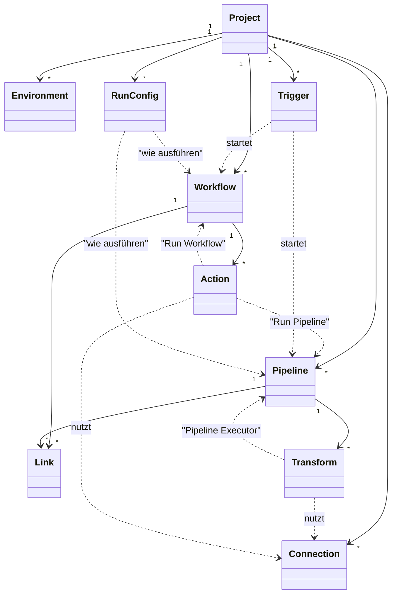
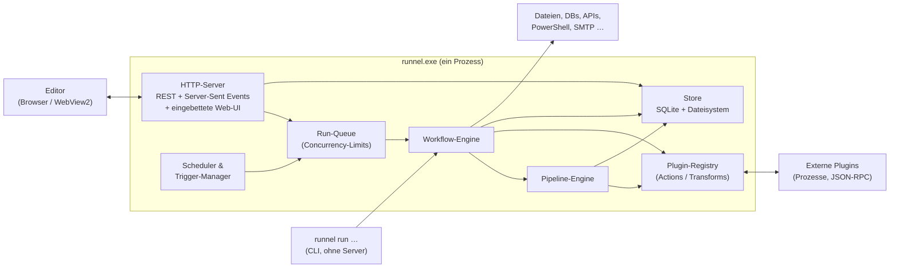
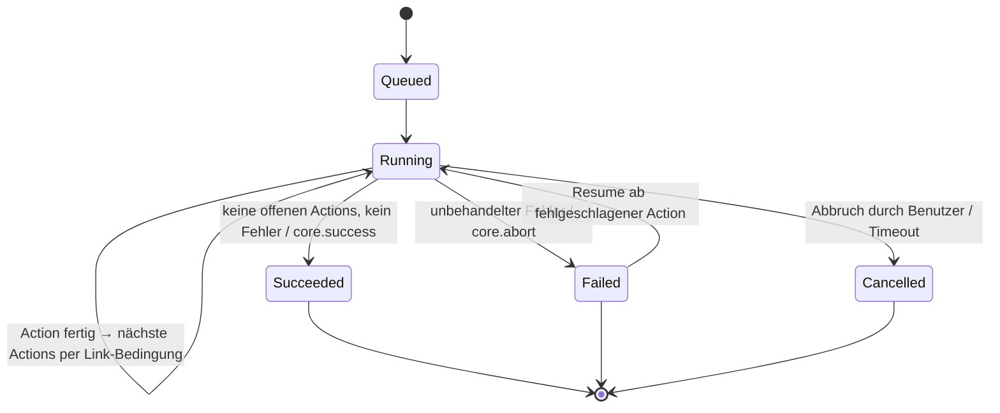
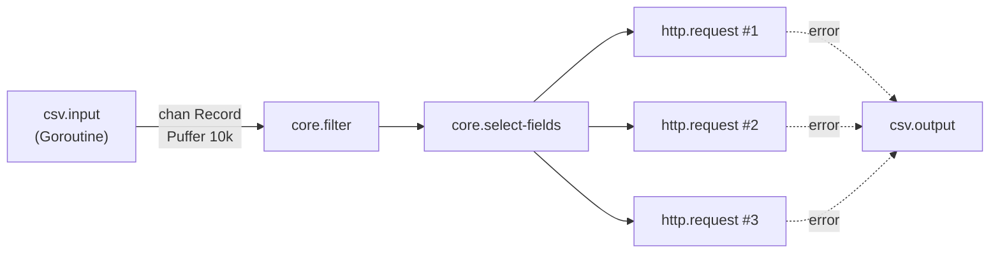

# Runnel – Konzept & technische Architektur

> Leichtgewichtige Workflow- und Datenintegrations-Plattform für Windows.
> Eine einzige ausführbare Datei, kein Docker, keine Java-/Node-Runtime, keine externe Datenbank.

Status: Entwurf v0.1 · Stand: 2026-11-18

---

## 1. Ziele & Abgrenzung

### 1.1 Vision

Runnel verbindet die **visuelle Einfachheit von n8n/Make** mit dem **sauberen Modell von Apache Hop**
(Workflows für Ablaufsteuerung, Pipelines für Datenströme) – betrieben als **eine schlanke Windows-Anwendung**,
die man per Doppelklick startet oder als Windows-Dienst installiert.

### 1.2 Kernziele

| Ziel | Messbares Kriterium |
|---|---|
| Kein Overhead | Eine `runnel.exe` (< 40 MB), keine Abhängigkeiten, Start < 1 s, < 60 MB RAM im Leerlauf |
| Windows-first | Läuft als Dienst, nutzt DPAPI für Secrets, PowerShell-Integration, Pfade/Freigaben (UNC) |
| Zwei Komponenten | **Editor** (Designen) und **Runner** (Ausführen) – getrennt nutzbar, gleiche Dateiformate |
| Git-freundlich | Workflows/Pipelines als lesbare YAML-Dateien, diff- und reviewbar |
| Erweiterbar | Plugins in beliebiger Sprache (Prozess-Protokoll) oder als JavaScript |
| Headless betreibbar | Runner per CLI ohne UI ausführbar (CI, Aufgabenplanung, Server) |

### 1.3 Nicht-Ziele (v1)

- Kein Multi-Tenant-SaaS, **keine Benutzer-/Rollenverwaltung** (wie bei Apache Hop; s. [ADR 0005](adr/0005-mehrbenutzerbetrieb.md))
- Kein Cluster / verteilte Ausführung (Remote-Runner erst in späterer Phase, s. Roadmap)
- Kein Big-Data-Backend (kein Spark/Beam/Flink wie bei Apache Hop) – Fokus auf Datenmengen bis ca. einige Mio. Zeilen pro Lauf
- Keine 400+ SaaS-Konnektoren wie Make/n8n – stattdessen starke generische Bausteine (HTTP, SQL, Dateien, Skript) plus Plugin-Modell

### 1.4 Positionierung

| | n8n | Make | Apache Hop | **Runnel** |
|---|---|---|---|---|
| Runtime | Node.js (+DB) | Cloud | Java (JVM) | **Native Binary** |
| Betrieb Windows | möglich, aufwendig | – (SaaS) | möglich, schwergewichtig | **Doppelklick / Dienst** |
| Modell | Item-basierter Graph | Szenario | Workflow + Pipeline | **Workflow + Pipeline** |
| Datenstrom/ETL | eingeschränkt | eingeschränkt | stark | **mittel–stark** |
| Speicherformat | DB (JSON export) | Cloud | XML-Dateien | **YAML-Dateien** |
| Footprint | ~300 MB+ | – | ~500 MB+ | **~40 MB** |

---

## 2. Fachliches Modell (Konzepte)

Das Modell (Workflow/Pipeline) lehnt sich an Apache Hop an; die Begriffe sind bewusst allgemein gehalten – Verbindungen heißen **Links** ([ADR 0009](adr/0009-begriff-link.md)).



### 2.1 Project

Ein Ordner im Dateisystem – die Einheit für Versionierung (Git), Deployment und Berechtigungen.

```
my-project/
├─ project.yaml              # Name, Version, Default-Environment, Plugin-Pfade
├─ environments/
│   ├─ dev.yaml              # Variablen je Umgebung
│   └─ prod.yaml
├─ connections/
│   └─ erp-sql.yaml          # DB-/HTTP-/SMTP-/SFTP-Verbindungen (ohne Klartext-Secrets)
├─ triggers/
│   └─ nightly-import.yaml   # Cron, Webhook, File-Watch
├─ run-configs/
│   └─ local-fast.yaml       # Wie wird ausgeführt (Puffer, Logging, Sampling …)
├─ workflows/
│   └─ nightly-import.workflow.yaml
├─ pipelines/
│   └─ customers-to-crm.pipeline.yaml
└─ scripts/                  # gemeinsam genutzte JS-/PowerShell-Skripte
```

### 2.2 Workflow (Ablaufsteuerung)

- Ein **gerichteter Graph aus Actions**, verbunden durch **Links**.
- Actions laufen **sequenziell entlang der Links** (optional parallel verzweigt).
- Jede Action liefert ein **Result**: `success | failure` plus Ergebnisdaten (Variablen, Dateiliste, Zeilenanzahl, Exit-Code …).
- Links tragen eine **Bedingung**:
  - `success` (grün) – nur wenn Vorgänger erfolgreich
  - `failure` (rot) – nur wenn Vorgänger fehlgeschlagen
  - `always` (schwarz) – unabhängig vom Ergebnis
  - `expression` (blau) – frei formulierte Bedingung, z. B. `{{ result.rows > 0 }}`
- Typische Actions: Start, Pipeline ausführen, Sub-Workflow ausführen, PowerShell, HTTP, Datei-Operationen, Mail, Warten, SQL ausführen, Erfolg/Abbruch.
- Schleifen sind erlaubt, aber nur explizit (Link zurück mit Bedingung oder „Loop“-Action) und durch `maxIterations` begrenzt.

### 2.3 Pipeline (Datenfluss)

- Ein **gerichteter, azyklischer Graph aus Transforms**.
- **Alle Transforms laufen gleichzeitig** (wie in Apache Hop) und reichen **Records** über Links (gepufferte Kanäle) weiter → Streaming, konstanter Speicherverbrauch.
- Ein Record ist ein **geordnetes, JSON-artiges Objekt** (Feldname → Wert). Pipelines sind **schemalos mit optionalen Typen** (string, int, decimal, float, bool, date, datetime, binary, json) – Details: [ADR 0007](adr/0007-typsystem-pipelines.md).
- Links in Pipelines:
  - Normaler **Daten-Link**
  - **Fehler-Link**: fehlerhafte Records werden mit Fehlerinfos (`_error.message`, `_error.field`) umgeleitet statt die Pipeline abzubrechen
  - **Info-Link**: Nebeneingang (z. B. Lookup-Daten für „Stream Lookup“)
- Verteilungsmodus bei mehreren Ausgängen: `copy` (jeder Ausgang bekommt jeden Record) oder `distribute` (Round-Robin), wie in Apache Hop.
- Transforms können mit **mehreren Kopien** (Parallelität) laufen, z. B. für teure HTTP-Lookups.

### 2.4 Link

Verbindung zwischen zwei Knoten. Im Workflow = Kontrollfluss mit Bedingung, in der Pipeline = Datenkanal.
Links können deaktiviert werden (bleiben im Design, werden nicht ausgeführt).

### 2.5 Environment & Variablen

- Variablen werden über Ebenen aufgelöst (spätere Ebene überschreibt):
  1. Standardwerte der Workflow-Parameter (`parameters[].default`)
  2. Project (`project.yaml`, Abschnitt `variables`)
  3. Environment (`environments/<name>.yaml`; Auswahl per `--env`, sonst `defaultEnvironment` des Projekts)
  4. Beim Start übergebene Parameter (CLI `--param KEY=VALUE`, Webhook-Body, Trigger, aufrufende Action)
  5. Zur Laufzeit gesetzte Variablen (Action „Set Variables“, ab S08)
- Syntax:
  - `${NAME}` – Variable aus den Ebenen oben (kompatibel zu Apache Hop); Werte dürfen selbst Variablen enthalten
    (z. B. `INBOX: ${BASE}\inbox`), Zyklen sind ein Fehler
  - `${env:NAME}` – Umgebungsvariable des Betriebssystems, z. B. `${env:COMPUTERNAME}`, `${env:TEMP}`
  - `${secret:NAME}` – Secret aus dem Secret-Store (Kap. 8)
  - `$${` – ein wörtliches `${`
  - `{{ expression }}` – Ausdruck in [`expr-lang`](https://github.com/expr-lang/expr), z. B. `{{ formatDate(now(), 'yyyyMMdd') }}`, `{{ record.amount * 1.19 }}` – Details und Funktionsbibliothek: [ADR 0006](adr/0006-ausdruckssprache.md)
- Das Projekt wird über `project.yaml` im Ordner des Workflows oder einem übergeordneten Ordner gefunden (wie `.git`).
- `runnel validate` meldet nicht definierte Variablen als Warnung – je Environment des Projekts, damit z. B. eine nur in
  `dev` gesetzte Variable für `prod` auffällt.

```yaml
# project.yaml
kind: Project
apiVersion: runnel/v1
name: my-project
defaultEnvironment: dev
variables:
  BASE: D:\data
  INBOX: ${BASE}\inbox
```

```yaml
# environments/prod.yaml – der Name muss dem Dateinamen entsprechen
kind: Environment
apiVersion: runnel/v1
name: prod
variables:
  BASE: \\fileserver\data
```

### 2.6 Connection & Credentials

Wiederverwendbare Metadaten-Objekte (DB, HTTP-API, SMTP, SFTP, SharePoint …).
Secrets werden **nie im Klartext in YAML** gespeichert, sondern referenziert: `password: ${secret:erp-sql-password}`.
Der Secret-Store ist lokal verschlüsselt (siehe Kap. 8).

### 2.7 Trigger

| Typ | Beschreibung |
|---|---|
| `manual` | Start über UI oder CLI |
| `cron` | Zeitplan (Cron-Syntax + Zeitzone), Optionen: kein paralleler Lauf, Nachholen verpasster Läufe |
| `webhook` | HTTP-Endpunkt `/hooks/{name}`, Body/Query werden zu Parametern, synchrone oder asynchrone Antwort |
| `file` | Dateisystem-Überwachung (Ordner + Pattern), z. B. neue CSV in Eingangsordner |
| `interval` | Polling alle n Sekunden/Minuten |

Trigger können sowohl Workflows als auch Pipelines direkt starten.

### 2.8 Ausführungsvarianten

Details: [ADR 0008](adr/0008-ausfuehrungsvarianten.md).

| Variante | Umsetzung |
|---|---|
| Workflow oder einzelne Pipeline direkt ausführen | CLI, Editor, API, Trigger |
| **Run-Konfiguration** (wie wird ausgeführt) | Metadaten-Objekt `RunConfig` (`local`, später `remote`): Puffergrößen, Parallelität, Sampling, Log-Level, Timeout. Auswahl per CLI, Editor, Trigger oder aufrufender Action |
| Dynamisches Ziel | `pipeline: "pipelines/import-${MANDANT}.pipeline.yaml"`, optional eingeschränkt über `allowedTargets` |
| Ausführung pro Datensatz (Pipeline) | `core.pipeline-executor`, `core.workflow-executor` – pro Datensatz, pro Gruppe fester Größe oder pro Feldwechsel |
| Ausführung pro Datensatz (Workflow) | `forEachRow` an `core.run-pipeline` / `core.run-workflow`, optional parallel |
| Datensätze zwischen Pipelines weitergeben | `core.to-result` / `core.from-result` |
| Teilausführung | Editor: „Ab hier ausführen“, „Nur diese Action ausführen“, Pipeline-Vorschau bis Transform X |
| Später | Mappings (wiederverwendbare Unter-Pipelines), Remote-Ausführung |

### 2.9 KI-Funktionen

Details: [ADR 0012](adr/0012-ki-faehigkeit.md).

| Baustein | Umsetzung |
|---|---|
| Sprachmodelle | Action `ai.chat`; Anbieter (Anthropic, OpenAI-kompatibel, Ollama lokal) als Connection, Schlüssel per `${secret:…}` |
| Agenten | Action `ai.agent`: Schleife Modell → Werkzeug → Modell innerhalb der Action; Werkzeuge per Positivliste (`with.tools`) |
| Werkzeug-Vertrag | Workflows mit typisierten `parameters` (`type`, `enum`, `description`) und `outputs` – gilt für Sub-Workflows, Agenten, MCP und Webhooks |
| MCP | Server: `runnel mcp` stellt Workflows als Tools bereit; Client: Action `mcp.call-tool`; MCP-Server als Plugin-Quelle |
| RAG | Pipelines mit `ai.chunk`, `ai.embed` und Vektor-Ausgabe (pgvector, Qdrant) |
| Leitplanken | Positivliste, Freigabe-Action `core.approval`, Protokollierung jedes Modell-/Werkzeugaufrufs, Maskierung von Secrets, Schritt-, Rate- und Kostenlimits |

---

## 3. Systemarchitektur

### 3.1 Überblick



### 3.2 Die zwei Kernkomponenten

**Runner / Executor** (`runnel run`, `runnel serve`)
- Lädt Workflow-/Pipeline-YAML, validiert, löst Variablen auf, führt aus.
- Funktioniert **vollständig ohne Editor und ohne Server** (`runnel run workflows/x.workflow.yaml --env prod`) – ideal für Windows-Aufgabenplanung oder CI.
- Im Server-Modus zusätzlich: Scheduler, Trigger, Ausführungshistorie, Live-Status.

**Editor**
- Web-Single-Page-App, **in die exe eingebettet** (`go:embed`) und unter `http://localhost:7300` erreichbar.
- Optional als Desktop-Fenster: `runnel desktop` öffnet die UI in einem **WebView2**-Fenster (in Windows 10/11 bereits vorhanden) – fühlt sich an wie eine native App, ohne Electron.
- Der Editor arbeitet direkt auf den Projektdateien (über die REST-API des lokalen Servers) → was man im Editor speichert, ist sofort per CLI ausführbar.

### 3.3 Betriebsmodi

| Modus | Befehl | Einsatz |
|---|---|---|
| Einmal-Ausführung | `runnel run <datei> [--env prod] [--param k=v] [--run-config name]` | Aufgabenplanung, CI, Skripte. Exit-Code: 0 erfolgreich, 1 fehlgeschlagen, 2 nicht gestartet, 130 abgebrochen |
| Server | `runnel serve [--project D:\flows]` | Editor + Scheduler + Webhooks |
| Desktop | `runnel desktop` | Server + WebView2-Fenster (Einzelplatz) |
| Windows-Dienst | `runnel service install/start/stop/uninstall` | Dauerbetrieb auf Server |
| Validierung | `runnel validate <datei/ordner>` | Lint/Prüfung in CI |
| Portable | `runnel.exe` + `runnel.portable` im Ordner | Alle Daten neben der exe, z. B. USB / Netzlaufwerk |

---

## 4. Technologie-Stack

### 4.1 Entscheidung: Go für Backend/Runner

| Kriterium | Go | .NET 9 (AOT) | Node/Electron | Rust |
|---|---|---|---|---|
| Single-Binary ohne Runtime | ✅ nativ | ✅ (AOT mit Einschränkungen bei Reflection) | ❌ | ✅ |
| Nebenläufigkeit für Pipelines | ✅ Goroutinen + Channels ideal | ✅ Channels/Tasks | ⚠️ Single-Thread | ✅ (komplexer) |
| Windows-Dienst | ✅ `x/sys/windows/svc` | ✅ | ⚠️ | ✅ |
| DB-Treiber ohne CGO | ✅ MSSQL, Postgres, MySQL, Oracle, SQLite | ✅ | ✅ | ⚠️ |
| Entwicklungsgeschwindigkeit | ✅ hoch | ✅ hoch | ✅ hoch | ⚠️ mittel |
| Cross-Compile Linux/macOS | ✅ trivial | ✅ | ⚠️ | ✅ |

**Entscheidung: Go** ([ADR 0002](adr/0002-go-backend.md)). Das Goroutine/Channel-Modell bildet Links in Pipelines 1:1 ab,
die Binary ist klein und ohne CGO cross-kompilierbar. .NET 9 wurde als Alternative betrachtet und verworfen.

### 4.2 Bibliotheken (Backend)

| Zweck | Bibliothek |
|---|---|
| HTTP-Router | `net/http` (Go 1.22+ Routing) |
| Live-Events | Server-Sent Events mit `net/http` ([ADR 0016](adr/0016-live-events-sse.md)) |
| Lokale DB | `modernc.org/sqlite` (pure Go, kein CGO) |
| YAML | `gopkg.in/yaml.v3` / `goccy/go-yaml` (bessere Fehlermeldungen mit Zeilennummer) |
| JSON-Schema-Validierung | `santhosh-tekuri/jsonschema` |
| Ausdrücke | `expr-lang/expr` (kompiliert, schnell, ohne Seiteneffekte) |
| Skript-Bausteine | `dop251/goja` (JavaScript, eingebettet, sandboxbar) |
| Exakte Dezimalzahlen | `shopspring/decimal` |
| Cron | `robfig/cron/v3` |
| Dateiüberwachung | `fsnotify/fsnotify` |
| Windows-Dienst / DPAPI / EventLog | `golang.org/x/sys/windows`, `.../svc`, `.../svc/eventlog` |
| SQL Server | `microsoft/go-mssqldb` (inkl. Windows-Authentifizierung) |
| PostgreSQL | `jackc/pgx/v5` |
| MySQL/MariaDB | `go-sql-driver/mysql` |
| Oracle | `sijms/go-ora` (pure Go) |
| ODBC (optional, Access, Legacy) | `alexbrainman/odbc` |
| Excel | `xuri/excelize/v2` |
| CSV | `encoding/csv`, Kodierungen mit `golang.org/x/text` (Windows-1252, UTF-16) |
| SFTP | `pkg/sftp` + `x/crypto/ssh` |
| Mail | `wneessen/go-mail` |
| Logging | `log/slog` (strukturiert, JSON) |
| WebView2-Fenster | `jchv/go-webview2` oder Wails v2 |

### 4.3 Frontend (Editor)

| Zweck | Wahl |
|---|---|
| Framework | **React 19 + TypeScript**, Build mit **Vite** |
| Graph-Canvas | **React Flow (xyflow)** – Knoten, Links, Zoom; Auto-Layout mit `@dagrejs/dagre` (MIT; `elkjs` scheidet wegen EPL-2.0/GPL-3.0 aus) |
| Formulare | Automatisch aus JSON-Schema der Action/Transform generiert (`@rjsf/core` oder eigene schlanke Lösung) |
| Code-/Ausdruckseditor | **CodeMirror 6** (Autovervollständigung für Variablen, Felder, Funktionen; S35, Nachtrag in ADR 0006) |
| Zustand | `zustand` + Undo/Redo-Stack (Command-Pattern) |
| Datenvorschau | Virtualisierte Tabelle (`@tanstack/react-table` + `react-virtual`) |
| UI-Kit | `shadcn/ui` + Tailwind (leicht, kein schweres Komponenten-Framework) |
| Gestaltung | Design Tokens aus [`design/tokens`](../design/README.md) (Farben, Schriften, Radien, hell/dunkel) – [ADR 0011](adr/0011-corporate-design.md) |

Ziel-Bundle: < 3 MB gzip, wird in die exe eingebettet. Schriften (Inter, JetBrains Mono) liegen lokal unter
`design/fonts/`. Weitere Bibliotheken der Tabelle werden erst mit dem Schritt aufgenommen, der sie braucht – mit
Begründung im PR. Entwicklung: [docs/dev/EDITOR.md](dev/EDITOR.md).

---

## 5. Dateiformate

YAML, menschenlesbar, stabil sortiert (minimale Git-Diffs). Layout-Informationen (Koordinaten) liegen im selben Dokument,
aber in einem eigenen `layout`-Block, damit Logik-Diffs nicht vom Verschieben eines Knotens überlagert werden.

### 5.1 Workflow

```yaml
# workflows/nightly-import.workflow.yaml
kind: Workflow
apiVersion: runnel/v1
name: nightly-import
description: Lädt Kunden aus dem ERP und überträgt sie ins CRM
parameters:
  - name: IMPORT_DATE
    default: "{{ formatDate(addDays(today(), -1), 'yyyy-MM-dd') }}"
settings:
  timeout: 2h
  maxConcurrentRuns: 1

actions:
  - id: start
    type: core.start

  - id: wait-file
    type: file.wait
    with:
      path: "${INBOX}\\customers_${IMPORT_DATE}.csv"
      maxWait: 30m

  - id: load
    type: core.run-pipeline
    with:
      pipeline: pipelines/customers-to-crm.pipeline.yaml
      params:
        FILE: "${INBOX}\\customers_${IMPORT_DATE}.csv"
    retry: { attempts: 3, backoff: 1m }

  - id: archive
    type: file.move
    with:
      source: "${INBOX}\\customers_${IMPORT_DATE}.csv"
      target: "${ARCHIVE}\\"

  - id: notify-error
    type: mail.send
    with:
      connection: smtp-office365
      to: "${ADMIN_MAIL}"
      subject: "Import fehlgeschlagen: {{ run.id }}"
      body: "{{ run.lastError }}"

  - id: abort
    type: core.abort

links:
  - { from: start,     to: wait-file }
  - { from: wait-file, to: load,         when: success }
  - { from: load,      to: archive,      when: success }
  - { from: wait-file, to: notify-error, when: failure }
  - { from: load,      to: notify-error, when: failure }
  - { from: notify-error, to: abort }

layout:                 # Pixel, linke obere Ecke des Knotens (Karte 176 × 52 px)
  start:        { x: 40,  y: 120 }
  wait-file:    { x: 280, y: 120 }
  load:         { x: 520, y: 120 }
  archive:      { x: 760, y: 120 }
  notify-error: { x: 520, y: 280 }
  abort:        { x: 760, y: 280 }
```

Regeln des Workflow-Formats (umgesetzt in `internal/model`):

- Pflichtfelder: `kind: Workflow`, `apiVersion: runnel/v1`, `name`; je Action `id` und `type`; je Link `from` und `to`.
- Action-IDs: Buchstaben, Ziffern, `-` und `_`, beginnend mit einem Buchstaben. Action-Typen: `<namespace>.<name>`, z. B. `file.copy`.
- Parameternamen: Buchstaben, Ziffern und `_`, nicht mit einer Ziffer beginnend (für `${NAME}`).
- Parameter können einen Typ haben (`type`: `string` – Standard –, `integer`, `number`, `boolean`, `json`) und erlaubte
  Werte (`enum`); Standardwerte und beim Start übergebene Werte werden dagegen geprüft. Als Variable `${NAME}` bleibt der
  Wert Text.
- `outputs` (Name, optional Typ und Beschreibung, `value`) bilden das Ergebnis eines Workflows; sie werden nur bei
  erfolgreichem Ende ausgewertet. Parameter und Outputs sind der Werkzeug-Vertrag für Sub-Workflows, Agenten und MCP
  ([ADR 0012](adr/0012-ki-faehigkeit.md)).
- Link-Bedingung `when`: `success` (Standard, wenn nicht angegeben), `failure`, `always` oder ein Ausdruck `{{ … }}`.
- Zeitangaben: Go-Syntax mit Einheit, z. B. `30s`, `5m`, `2h`, `1h30m`.
- Unbekannte Felder sind ein Fehler (Schutz vor Tippfehlern); gemeldet werden alle auf einmal, nach Position sortiert,
  mit Vorschlag bei ähnlichem Namen (`unknown field "tpye" (did you mean "type"?)`). Fehler werden mit Datei, Zeile und Spalte gemeldet;
  alle Feldfehler einer Datei auf einmal.
- Eine Datei enthält genau ein YAML-Dokument.
- Graph (`runnel validate`): genau eine Action vom Typ `core.start` ohne eingehende Links; eindeutige Action-IDs;
  Links nur zwischen existierenden Actions; Zyklen nur über Links mit `loop: true`.
  Warnungen: vom Start aus unerreichbare Actions, doppelte Links, `loop: true` ohne Rücksprung,
  `joinTimeout` bei `join: first/each`, Layout-Einträge für unbekannte Actions.

### 5.2 Pipeline

```yaml
# pipelines/customers-to-crm.pipeline.yaml
kind: Pipeline
apiVersion: runnel/v1
name: customers-to-crm
parameters:
  - name: FILE
settings:
  bufferSize: 10000          # Records pro Link-Puffer (Backpressure)

transforms:
  - id: read
    type: csv.input
    with:
      path: "${FILE}"
      delimiter: ";"
      encoding: windows-1252
      header: true
      fields:
        - { name: kdnr,   type: int }
        - { name: name,   type: string }
        - { name: umsatz, type: decimal, format: "#.##0,00" }

  - id: only-active
    type: core.filter
    with:
      condition: "{{ record.umsatz > 0 }}"

  - id: map
    type: core.select-fields
    with:
      fields:
        - { from: kdnr, to: externalId }
        - { from: name, to: companyName }
        - { name: importedAt, value: "{{ now() }}" }

  - id: to-crm
    type: http.request
    copies: 4                # 4 parallele Instanzen
    with:
      connection: crm-api
      method: POST
      url: /api/accounts
      body: "{{ record }}"

  - id: rejected
    type: csv.output
    with:
      path: "${ARCHIVE}\\rejected_${IMPORT_DATE}.csv"

links:
  - { from: read,        to: only-active }
  - { from: only-active, to: map }
  - { from: map,         to: to-crm }
  - { from: to-crm,      to: rejected, type: error }
```

Regeln des Pipeline-Formats (umgesetzt in `internal/model`, Stand S12; das Beispiel oben zeigt den Zielumfang):

- Pflichtfelder: `kind: Pipeline`, `apiVersion: runnel/v1`, `name`; je Transform `id` und `type`; je Link `from` und `to`.
  Dazu `description`, `parameters` (wie bei Workflows, ohne `outputs`) und je Transform `with`.
- Transform-IDs wie Action-IDs; Typen `<namespace>.<name>` in einem eigenen Namensraum ([ADR 0013](adr/0013-typnamen-namensraeume.md)).
  Ob ein Typ existiert und seine Konfiguration passt, prüfen `runnel validate` und der Start eines Laufs (seit S13b).
- Links sind Daten-Links (`type: data`, Standard). **Fehler werden nur über Links behandelt** (`type: error`, mit S17),
  nicht über ein Feld am Transform – wie die Fehlerpfade (`when: failure`) bei Workflows. `type: info` folgt mit S23;
  bis dahin meldet `runnel validate` beide als „noch nicht unterstützt“ (der Editor zeigt Pipelines bis S25a nur als YAML).
- Graph: mindestens ein Transform, eindeutige IDs, Links nur zwischen vorhandenen Transforms, keine Links auf sich
  selbst und **keine Zyklen** (Datensätze fließen nur vorwärts). Warnungen: doppelte Links, Transforms ohne Verbindung.
- `copies`, `settings` (z. B. `bufferSize`), `disabled`, `layout` und der Verteilmodus kommen mit den Schritten, die sie
  ausführen (S13, S17, S25a); bis dahin sind sie unbekannte Felder.
- `runnel validate` prüft `*.pipeline.yaml` mit; `runnel run` führt Pipelines aus und zeigt am Ende je Transform, wie viele
  Records er gelesen und geschrieben hat (seit S13b).

### 5.3 Trigger

```yaml
kind: Trigger
apiVersion: runnel/v1
name: nightly-import
type: cron
target: workflows/nightly-import.workflow.yaml   # auch Pipelines möglich
environment: prod
runConfig: local-fast
with:
  schedule: "0 2 * * 1-5"
  timezone: Europe/Berlin
  overlap: skip            # skip | queue | allow
```

---

## 6. Ausführungs-Engine

### 6.1 Workflow-Engine



Ablauf:
1. **Laden & Validieren**: YAML parsen, gegen JSON-Schema prüfen, Action-Typen in der Registry auflösen, Graph prüfen (Start vorhanden, keine unerreichbaren Knoten, Zyklen nur mit Limit).
2. **Kontext aufbauen**: Variablen-Scopes, Credentials (lazy entschlüsselt), Logger, `context.Context` für Abbruch/Timeout.
3. **Ausführen**: Ab `start` werden Actions in eine Ready-Queue gelegt. Jede Action läuft in einer Goroutine; nach Abschluss werden die ausgehenden Links ausgewertet und Nachfolger „bereit“ gesetzt.
   - **Parallelität**: Hat eine Action mehrere erfüllte ausgehende Links, laufen die Nachfolger parallel.
   - **Fehler in einem Zweig**: Die anderen Zweige laufen zu Ende; ein von keinem Link behandelter Fehler lässt den Workflow danach fehlschlagen. `core.success`/`core.abort` beenden sofort und brechen laufende Zweige ab.
   - **Join**: Konfigurierbar pro Action (`join: all | first | each`), Projektstandard `all`: Eine Action mit mehreren eingehenden Links startet einmal, sobald alle Vorgänger fertig sind, die noch ein Signal liefern können (Dead-Path-Elimination; nicht durchlaufene Actions erhalten den Status `skipped`). Details: [ADR 0003](adr/0003-join-semantik.md).
4. **Fehlerbehandlung je Action**: `retry` (`attempts` = Versuche insgesamt, `backoff` = Wartezeit vor dem zweiten Versuch, `strategy: fixed|exponential`), `timeout` (gilt je Versuch), `continueOnError`. `settings.timeout` begrenzt den ganzen Workflow; ein Abbruch (Strg+C) stoppt laufende Actions, folgt keinen Fehler-Links und endet mit Status `cancelled`.
   **Ergebnis des Workflows:** `core.success` beendet ihn erfolgreich, `core.abort` als fehlgeschlagen (ohne Fehler-Links). Folgt auf eine Action kein Link mehr, entscheidet ihr Ergebnis: Ein Fehler, den kein Fehler- oder Immer-Link behandelt, lässt den Workflow fehlschlagen. Enthält der Workflow ein `core.success`, das im Lauf nicht erreicht wurde (z. B. wegen eines deaktivierten Links), endet er trotzdem erfolgreich, aber mit der Warnung `workflow ended without reaching its end action "…"` im Log. Eine Action darf höchstens 10.000-mal je Lauf ausgeführt werden (Schutz vor Endlosschleifen).
5. **Persistenz**: Jeder Statuswechsel wird in SQLite geschrieben (Run, ActionRun, Ergebnis, Dauer) → Live-Anzeige im Editor und **Resume** nach Absturz/Fehler ab der fehlgeschlagenen Action.

Schnittstelle einer Action (Go):

```go
type Action interface {
    // Wird beim Laden aufgerufen – Konfiguration prüfen, Defaults setzen.
    Init(cfg ActionConfig) error
    // Führt die Action aus. ctx wird bei Abbruch/Timeout gecancelt.
    Execute(ctx context.Context, ec *ExecContext) (Result, error)
}

type Result struct {
    Success   bool
    ExitCode  int
    Rows      int64
    Files     []string
    Variables map[string]any   // werden für Nachfolger sichtbar
    Output    any               // beliebiges JSON-Ergebnis
}
```

### 6.2 Pipeline-Engine



- Jeder Transform (bzw. jede Kopie) ist eine **Goroutine**, jeder Link ein **gepufferter Channel** von Record-Batches.
- **Batching**: Records werden intern in Batches (z. B. 500) übertragen, um Channel-Overhead zu minimieren; für den Transform-Entwickler unsichtbar.
- **Backpressure** entsteht automatisch: Volle Puffer blockieren den Erzeuger → konstanter Speicher auch bei großen Dateien.
- **Ende-Signal**: Schließen des Channels propagiert durch den Graphen; die Pipeline ist fertig, wenn alle Transforms beendet sind.
- **Fehler**: Pro Record → Fehler-Link (falls vorhanden), sonst Pipeline-Abbruch (alle Goroutinen via Context gecancelt). Schwelle konfigurierbar (`maxErrors: 100`).
- **Metriken** je Transform: gelesen/geschrieben/Fehler/Records pro Sekunde/Puffer-Füllstand – live per Server-Sent Events im Editor (vergleichbar mit dem „Metrics“-Tab in Apache Hop).
- **Transaktionen**: DB-Outputs mit `commitSize`; optional „Unique Connection“-Modus (eine Transaktion über die ganze Pipeline, Rollback bei Fehler).

Schnittstelle eines Transforms (Go, umgesetzt mit S13a in `internal/transform`):

```go
type Transform interface {
    // Process liest die Batches von in, bis der Kanal geschlossen ist, und gibt Records
    // mit out.Emit weiter. Ein Fehler hält die ganze Pipeline an.
    Process(ctx context.Context, in <-chan Batch, out *Output) error
}

// Output: Emit(record) – blockiert bei vollen Puffern (Backpressure), meldet den Abbruch;
// Logf(level, …) – Meldung ins Lauf-Log.
```

- **Mehrere Eingänge** eines Transforms werden zu einem Strom gemischt (Reihenfolge zwischen den Zweigen nicht
  festgelegt); **mehrere Ausgänge** bekommen jeden Record (`copy`), ab dem zweiten als Kopie, damit Zweige sich nicht
  gegenseitig verändern. `distribute` und `copies` folgen mit S17.
- Batches zu 500 Records, Puffer je Link 10.000 Records (feste Werte bis S17).
- Hört ein Transform vor dem Ende seiner Eingabe auf zu lesen, verwirft die Engine den Rest, damit die Transforms davor
  fertig werden. Eine Panik in einem Transform wird zum Fehler der Pipeline.
- **Zähler** je Transform: gelesen, geschrieben (Ereignis `transform.finished`, Ergebnis des Laufs).
- **Schema und Werttypen** (S14, ADR 0007 mit Nachtrag): Transforms können `Init(ic) → Schema` umsetzen; die Engine
  leitet die Schemas vor dem Lauf durch den Graphen ab, prüft verwendete Felder (`ic.Use`) und meldet Tippfehler mit
  Datei, Zeile und Spalte – als Fehler bei geschlossenem, als Warnung bei offenem Schema. `Process` bleibt unverändert;
  einfache Transforms wie `core.filter` (S16a) kommen mit einer Schleife in `Process` aus. Eigene Basistypen
  (`RowMapper`, `RowFilter`) werden erst eingeführt, wenn sich das Muster in mehreren Transforms wiederholt.
- **Ausdrücke je Datensatz** (S16a, ADR 0006): `record` und die Werte des Laufs (`vars`, `params`, `env`, `run`);
  Dezimalzahlen exakt, Rechnen mit `null` ergibt `null`, Größenvergleiche mit `null` sind `false`.

### 6.3 Datenvorschau & Debugging (Editor)

- **Preview**: Pipeline bis zu einem gewählten Transform mit `limit: 100` ausführen, Records je Link anzeigen (Tabelle + JSON).
- **Sampling im Lauf**: Bei jedem Lauf werden die ersten N Records pro Link gespeichert (abschaltbar) → nachträgliche Fehlersuche.
- **Breakpoints** (Phase 2): Pause bei Bedingung, z. B. `{{ record.kdnr == 4711 }}`.
- **Teilausführung im Workflow**: „Ab hier ausführen“ (optional mit Ergebnissen des letzten Laufs) und „Nur diese Action ausführen“ (s. [ADR 0008](adr/0008-ausfuehrungsvarianten.md)).

### 6.4 Run-Queue & Ressourcen

- Globales Limit gleichzeitiger Runs (`maxConcurrentRuns`), zusätzlich pro Workflow.
- Prioritäten (manuell > Webhook > Cron).
- Graceful Shutdown: Dienst-Stopp wartet konfigurierbar auf laufende Runs, danach Abbruch + Status `Cancelled` (resumebar).

---

## 7. Erweiterbarkeit (Plugins)

Drei Stufen – von einfach bis mächtig:

### 7.1 Stufe 1: Skript-Actions/-Transforms (JavaScript, eingebettet)

- Action `core.script` (Workflow) und Transform `core.script` (Pipeline) führen JS in **goja** aus. JavaScript gibt es nur hier; `{{ … }}`-Ausdrücke nutzen `expr-lang` ([ADR 0006](adr/0006-ausdruckssprache.md)).
- Sandbox: kein Dateisystem-/Netzwerkzugriff außer über bereitgestellte APIs (`http`, `fs` – per Projekteinstellung freischaltbar), CPU-Zeitlimit.
- Wiederverwendbare Skripte in `scripts/` werden über `require('./scripts/utils.js')` geladen.

### 7.2 Stufe 2: PowerShell / Shell

- `shell.powershell` mit Übergabe von Variablen als Parameter und Rückgabe von JSON (`ConvertTo-Json`) als Action-Ergebnis.
- Bevorzugt `pwsh.exe` (PowerShell 7), Fallback `powershell.exe` (5.1).
- In Pipelines: Transform `shell.powershell` – Records als NDJSON über stdin/stdout.

### 7.3 Stufe 3: Externe Plugins (beliebige Sprache)

Go-eigene Plugins (`plugin`-Paket) funktionieren unter Windows nicht – deshalb ein **prozessbasiertes Protokoll** (ähnlich LSP/HashiCorp go-plugin):

- Plugin = ausführbare Datei + `plugin.yaml` im Ordner `plugins/<name>/`.
- Jedes Plugin hat **einen eigenen Namensraum** (`namespace:`) und bietet nur Typen darin an; die Namensräume der
  eingebauten Bausteine sind reserviert ([ADR 0013](adr/0013-typnamen-namensraeume.md)).
- Kommunikation: **JSON-RPC 2.0 über stdin/stdout** (NDJSON), Logs über stderr.
- Methoden:
  - `describe` → liefert Liste der Actions/Transforms inkl. JSON-Schema der Eigenschaften, Icon (SVG), Kategorie, Ports
  - `action.execute` → einmaliger Aufruf, Ergebnis zurück
  - `transform.open` / `transform.batch` / `transform.close` → Streaming von Record-Batches
- Der Prozess wird pro Run (oder gepoolt) gestartet; Absturz eines Plugins reißt den Runner nicht mit.
- SDKs: Go (Referenz), Python, C#/.NET, Node – jeweils dünne Wrapper (~200 Zeilen).

```yaml
# plugins/sap-rfc/plugin.yaml
name: sap-rfc
version: 1.0.0
namespace: sap
executable: sap-rfc-plugin.exe
provides:
  actions: [sap.rfc-call]
  transforms: [sap.table-input]
```

### 7.4 Registry & UI-Integration

Alle Bausteine (eingebaut, JS, extern) beschreiben sich über denselben **Descriptor**
([ADR 0014](adr/0014-action-descriptor-schema.md)):

```json
{
  "type": "http.request",
  "kind": "transform",
  "category": "network",
  "label": "HTTP Request",
  "description": "Sends an HTTP request for each record",
  "schema": { "$schema": "https://json-schema.org/draft/2020-12/schema", "type": "object", "properties": { "...": {} } },
  "icon": "globe.svg",
  "ports": { "in": 1, "out": ["main", "error"] },
  "uiHints": { "body": { "widget": "code", "language": "json" } }
}
```

`type` bis `schema` gibt es seit E1 (`runnel catalog --json`); `icon`, `ports` und `uiHints` folgen mit den Schritten,
die sie brauchen. Eingebaute Bausteine erzeugen `schema` aus ihrem Konfigurations-Struct (Tags `json`, `doc`,
`schema`), Plugins liefern es fertig mit.

Der Editor rendert Palette und Eigenschaftsdialog **vollständig aus dem Descriptor** – neue Plugins brauchen keinen Frontend-Code.

**Typnamen** haben die Form `<namensraum>.<name>`. Actions und Transforms haben getrennte Registries: Derselbe Name
kann als Action (in Workflows) und als Transform (in Pipelines) existieren, z. B. `http.request`. Ein Namensraum gehört
genau einem Anbieter – Runnel selbst, einem Plugin oder einer MCP-Connection (`mcp-<connection>`)
([ADR 0013](adr/0013-typnamen-namensraeume.md)).

---

## 8. Sicherheit

| Thema | Lösung |
|---|---|
| Netzwerk | Server bindet standardmäßig nur an `127.0.0.1` und nimmt nur Anfragen an `localhost`/`127.0.0.1` ohne fremden `Origin` an (Schutz vor DNS-Rebinding und Anfragen fremder Webseiten). Für Netzzugriff explizit `--listen 0.0.0.0:7300` + TLS (eigenes Zertifikat oder selbstsigniert erzeugt) |
| Authentifizierung | **Keine Benutzerverwaltung** ([ADR 0005](adr/0005-mehrbenutzerbetrieb.md)). Lokal-Modus ohne Zugangsschutz; im Netzmodus ein gemeinsamer Zugangsschlüssel für den Server (+ TLS), gleichzeitig nutzbar als API-Token |
| Mehrere Browser | Ein Server, beliebig viele Editoren; Konfliktschutz per ETag, Live-Hinweis bei Änderungen anderswo, Zusammenarbeit über Git |
| Secrets | Secret-Store in SQLite, verschlüsselt mit AES-256-GCM. Schlüssel geschützt per **Windows DPAPI** (Maschinen- oder Dienstkonto-Scope); alternativ Master-Passwort (portabler Modus) oder Umgebungsvariable `RUNNEL_MASTER_KEY` |
| Secrets im Log | Automatische Maskierung aller bekannten Secret-Werte in Logs und Vorschauen |
| Webhooks | Pro Webhook eigenes Token (Header/Query) oder HMAC-Signaturprüfung, Rate-Limit |
| Skripte | JS-Sandbox mit Zeit-/Speicherlimit; Shell/PowerShell-Actions per Projekteinstellung deaktivierbar |
| Dienstkonto | Empfehlung: dedizierter Dienstbenutzer mit minimalen Rechten (bzw. gMSA in Domänen) |
| Audit | Dateiänderungen über den Editor, manuelle Starts und Abbrüche werden mit Client-Informationen (IP, Rechnername, User-Agent) protokolliert |

---

## 9. Persistenz & Logging

### 9.1 Was liegt wo?

| Daten | Ort | Format |
|---|---|---|
| Workflows, Pipelines, Trigger, Connections | Projektordner | YAML (Git) |
| Run-Historie, Status, Metriken, Samples | `data\runnel.db` | SQLite (WAL-Modus) |
| Secrets | `data\runnel.db` (Tabelle `secrets`) | verschlüsselt |
| Run-Logs | `data\logs\<jahr>\<run-id>.log` | JSON-Lines (slog) |
| Dienst-Ereignisse | Windows-Ereignisanzeige | EventLog-Quelle „Runnel“ |

Standardpfade: `%ProgramData%\runnel\` (Dienst) bzw. `%LOCALAPPDATA%\runnel\` (Desktop) bzw. neben der exe (portabel).

### 9.2 Datenmodell (SQLite, vereinfacht)

```sql
CREATE TABLE runs (
  id            TEXT PRIMARY KEY,          -- ULID (zeitlich sortierbar)
  kind          TEXT NOT NULL,             -- workflow | pipeline
  path          TEXT NOT NULL,             -- relativer Pfad im Projekt
  file_hash     TEXT NOT NULL,             -- Version der ausgeführten Definition
  environment   TEXT,
  trigger       TEXT,                      -- manual | cron:<name> | webhook:<name> | cli
  parent_run_id TEXT REFERENCES runs(id),  -- Sub-Workflow / Pipeline aus Workflow
  status        TEXT NOT NULL,             -- queued|running|succeeded|failed|cancelled
  params_json   TEXT,
  client_info   TEXT,                      -- IP/Rechnername bei manuellen Starts
  started_at    INTEGER, finished_at INTEGER,
  error         TEXT
);

CREATE TABLE node_runs (
  run_id     TEXT REFERENCES runs(id),
  node_id    TEXT,                         -- Action- oder Transform-ID
  attempt    INTEGER DEFAULT 1,
  status     TEXT,
  rows_in    INTEGER, rows_out INTEGER, rows_err INTEGER,
  result_json TEXT,
  started_at INTEGER, finished_at INTEGER,
  PRIMARY KEY (run_id, node_id, attempt)
);

CREATE TABLE samples (run_id TEXT, link TEXT, seq INTEGER, record_json TEXT);
CREATE TABLE secrets (name TEXT PRIMARY KEY, nonce BLOB, ciphertext BLOB, updated_at INTEGER);
```

Aufbewahrung: konfigurierbare Retention (z. B. 30 Tage Historie, 7 Tage Samples), Bereinigung durch internen Job.

### 9.3 Observability

- `/metrics` im Prometheus-Format (optional), `/health` für Monitoring (z. B. PRTG, Checkmk).
- Benachrichtigungen bei Fehlschlag: global konfigurierbarer „Error-Workflow“ (wie n8n), der bei jedem fehlgeschlagenen Run mit dessen Kontext gestartet wird.

---

## 10. API (Server-Modus)

REST unter `/api/v1`, JSON. Der Editor nutzt ausschließlich diese API – damit ist alles auch skriptbar.
Umgesetzte Endpunkte mit Statuscodes und Beispielen: [docs/dev/API.md](dev/API.md).

| Methode | Pfad | Zweck |
|---|---|---|
| GET | `/projects/current` · `/projects/current/tree` | Projekt (Name, Ordner) · Dateibaum des Projekts |
| GET/PUT/DELETE | `/files/{path}` | Workflow/Pipeline/Trigger lesen, speichern (mit ETag gegen Überschreiben) |
| POST | `/validate` | Definition prüfen (auch ungespeicherten Inhalt), Fehler mit Zeilen- und Knotenbezug (YAML-Pfad) |
| POST | `/workflows/edit` | Änderung vom Canvas zeilengenau auf den YAML-Text anwenden (verschieben, löschen, anlegen, umbenennen, Links), Kommentare bleiben erhalten (seit E6a/E6b) |
| GET | `/catalog` | Alle verfügbaren Actions/Transforms (Descriptors) |
| POST | `/runs` | Run starten `{ path, environment, params, runConfig, startAt?, only?, reuseResultsFrom? }` |
| GET | `/runs?status=&path=` | Historie (seit E3 im Speicher, Filter folgen mit S26 – zurückgestellt) |
| GET | `/runs/{id}` | Details inkl. Knotenstatus und Log |
| POST | `/runs/{id}/cancel` · `/runs/{id}/resume` | Steuern |
| POST | `/preview` | Pipeline-Vorschau bis Transform X |
| GET/PUT | `/secrets/{name}` | Secrets setzen (Wert nie lesbar zurück) |
| GET/POST | `/triggers`, `/triggers/{name}/enable` | Trigger verwalten |
| ANY | `/hooks/{name}` | Webhook-Endpunkte |
| GET | `/events?since=&run=` | Live-Events als Server-Sent Events ([ADR 0016](adr/0016-live-events-sse.md)): `run.started`, `run.finished`, `action.started`, `action.finished`, `action.skipped`, `log`; später Metriken und `file.changed` |

---

## 11. Editor – UX-Konzept

Die Oberfläche ist englisch ([ADR 0015](adr/0015-sprache-oberflaeche.md)).

```
┌────────────────────────────────────────────────────────────────────────────────┐
│ Runnel      Project: my-project ▾   Env: dev ▾            ▶ Run  ⏸  ⟲  💾     │
├───────────────┬──────────────────────────────────────────────┬─────────────────┤
│ Explorer      │                                              │ Properties      │
│ ▸ workflows   │    (Start)──▶[Wait for file]──✔──▶[Pipeline] │ HTTP Request    │
│ ▸ pipelines   │                    │✖           │✔           │ URL: ________   │
│ ▸ triggers    │                    ▼            ▼            │ Method: POST ▾  │
│ ▸ connections │              [Send mail]    [Archive]        │ Body: {{ … }}   │
│───────────────│                                              │ Retry: 3        │
│ Palette 🔍    │                                              │                 │
│ ▸ General     │                                              │                 │
│ ▸ Files       │                                              │                 │
│ ▸ Database    │                                              │                 │
│ ▸ Network     │                                              │                 │
├───────────────┴──────────────────────────────────────────────┴─────────────────┤
│ Logs │ Metrics │ Preview │ Problems │ History                                    │
│ 14:02:11 load        ✔  12,430 rows   1.8 s                                     │
└────────────────────────────────────────────────────────────────────────────────┘
```

Kernfunktionen:
- Drag & Drop aus der Palette, Links per Ziehen zwischen Ports, Link-Typ per Klick umschalten (✔/✖/∞/ƒ)
- Live-Status auf dem Canvas (Knotenfarbe, Zeilenzähler an Links)
- Inline-Validierung (rote Markierung am Knoten und am Feld im Panel „Properties“ + Tab „Problems“)
- Feld-Autovervollständigung: Der Editor kennt das Ausgabeschema jedes Transforms (aus `Init`) und schlägt Feldnamen vor
- Copy/Paste von Knoten als YAML (zwischen Instanzen und in Tickets/Chats teilbar)
- Tastatur-Shortcuts, Undo/Redo, Auto-Layout, Gruppierung/Notizen auf dem Canvas
- Dateiänderungen von außen (z. B. `git pull`) werden per `file.changed` erkannt und neu geladen

---

## 12. Mitgelieferte Bausteine (Zielumfang)

Actions und Transforms haben getrennte Typ-Namensräume ([ADR 0013](adr/0013-typnamen-namensraeume.md)); gleiche Namen
in beiden Listen (z. B. `http.request`, `core.log`) sind beabsichtigt.

### 12.1 Workflow-Actions

| Kategorie | Actions |
|---|---|
| Allgemein | Start, Erfolg, Abbruch, Warten, Dummy (`core.dummy` – Sammelpunkt für Zweige), Variablen setzen, Bedingung prüfen, Log schreiben, Schleife (ForEach über Liste/Dateien) |
| Ausführung | Pipeline ausführen, Workflow ausführen (jeweils optional `forEachRow`), JavaScript, PowerShell, Programm starten |
| Dateien | Existiert, Warten auf Datei, Kopieren, Verschieben, Löschen, Umbenennen, Ordner anlegen, ZIP/Entpacken, Dateiliste |
| Netzwerk | HTTP-Request, SFTP/FTP Upload/Download, Mail senden, Mail abrufen (IMAP) |
| Datenbank | SQL ausführen, Tabelle existiert, Zeilen zählen |

**Datei-Actions (umgesetzt mit S09):** `file.exists`, `file.wait`, `file.copy`, `file.move`, `file.delete`,
`file.mkdir`, `file.list`; Umbenennen ist `file.move` mit neuem Dateinamen als Ziel, ZIP/Entpacken folgt später.

- **Pfade:** Platzhalter `*`, `?` und `[abc]` sind im letzten Teil des Pfads erlaubt (`C:\in\*.csv`); unter Windows
  ohne Unterscheidung von Groß- und Kleinschreibung wie im Explorer. UNC-Pfade (`\\server\share\…`) funktionieren wie
  lokale; relative Pfade beziehen sich auf das Arbeitsverzeichnis von Runnel.
- **Ziel bei Kopieren/Verschieben:** Bei Platzhaltern, einem Ziel mit `\` am Ende oder einem vorhandenen Ordner landen
  die Dateien im Ordner; eine einzelne Datei kann auch unter neuem Namen abgelegt werden. Fehlende Ordner werden
  angelegt.
- **Konflikte:** Vorhandene Dateien werden nur mit `overwrite: true` ersetzt. Alle Ziele werden **vor** dem ersten
  Kopieren geprüft, damit ein Konflikt keinen halb erledigten Vorgang hinterlässt. Kopiert wird über eine temporäre
  Datei im Zielordner, der Änderungszeitpunkt bleibt erhalten; ein Abbruch des Laufs stoppt zwischen zwei Blöcken.
  Verschieben benennt innerhalb eines Laufwerks um, sonst kopiert es und löscht danach die Quelle.
- **Sicherheit beim Löschen:** Ordner nur mit `recursive: true` (sonst wird gar nichts gelöscht); nichts zu löschen ist kein Fehler (außer mit
  `mustExist: true`).
- **Ergebnis (`result.output`):** die gefundenen bzw. geschriebenen Pfade als Liste, bei `file.mkdir` der Pfad, bei
  `file.list` je Eintrag `path`, `name`, `size`, `modified` und `folder` – z. B.
  `{{ sum(map(results.list.output, .size)) }}`.
- **Warten:** `file.wait` prüft alle `interval` (Standard 5 s), gibt nach `maxWait` auf und wartet mit `stableFor`,
  bis sich die Größe nicht mehr ändert (Datei fertig geschrieben).

**Sub-Workflows (umgesetzt mit S11, [ADR 0017](adr/0017-sub-workflows.md)):** `core.run-workflow` ruft einen anderen
Workflow des Projekts auf und wartet auf sein Ende.

```yaml
- id: north
  type: core.run-workflow
  with:
    workflow: workflows/import-region.workflow.yaml   # relativ zum Projektordner
    params:
      REGION: north
      ORDERS: "{{ params.LIMIT }}"
```

- Das Kind erhält nur die Werte aus `params` (nicht deklarierte sind ein Fehler) sowie die Variablen von Projekt und
  Environment; seine `outputs` sind `result.output` der Action, z. B. `{{ results.north.output.IMPORTED }}`.
- Scheitert das Kind, scheitert die Action; ein Abbruch bricht auch das Kind ab.
- Meldungen des Kinds erscheinen im Log der Action als `import-region/check: …`.
- Feste Aufrufe prüft schon `runnel validate` (Datei, Parameter, Typen, Selbstaufruf); Pfade mit `${…}`/`{{ … }}` erst
  beim Lauf. `runConfig:` und `forEachRow` folgen mit S24.

### 12.2 Pipeline-Transforms

| Kategorie | Transforms |
|---|---|
| Eingabe | CSV, Excel, JSON/NDJSON, XML, Fixed-Width, Tabelleneingabe (SQL), REST-Eingabe (mit Paging), Zeilen generieren, Dateiliste |
| Transformation | Felder auswählen/umbenennen, Filter, Berechnen (Ausdruck), Wertzuordnung, Feld teilen, Typ konvertieren, String-Funktionen, Datum-Funktionen, JavaScript, Konstante hinzufügen, Sequenz |
| Fluss | Switch/Case, Kopieren/Verteilen, Anhängen (Append), Dummy, Blockieren bis fertig |
| Ausführung | Pipeline Executor, Workflow Executor, In Ergebnis kopieren (`core.to-result`), Aus Ergebnis lesen (`core.from-result`) |
| Kombination | Stream-Lookup, DB-Lookup, HTTP-Lookup, Merge-Join (inner/left/full), Sortieren, Gruppieren/Aggregieren, Duplikate entfernen, Pivot/Unpivot |
| Ausgabe | CSV, Excel, JSON, XML, Tabellenausgabe, Insert/Update (Upsert), Löschen, REST-Ausgabe, Log |

Umgesetzt (Stand S16a): `core.generate-rows`, `core.dummy`, `core.log`, `core.filter` sowie `csv.input` und
`csv.output`:

- **`core.filter`** reicht die Datensätze weiter, für die `condition` wahr ist (`{{ record.betrag > 0 }}`, die
  Klammern dürfen fehlen); die anderen werden verworfen, das Log nennt die Anzahl. Ein Ausgang für „falsch“ folgt mit
  den Link-Typen (S17).

- **`csv.input`** liest alle Spalten als Text (offenes Schema) oder mit `fields:` nur die genannten, mit Typ und Format
  (geschlossenes Schema). Spalten werden über die Kopfzeile gefunden, ohne Kopfzeile über die Position. Ein Wert, der
  nicht passt, hält die Pipeline mit Datei, Zeile und Spalte an. `encoding: auto` erkennt UTF-8 und UTF-16 am BOM und
  liest sonst UTF-8; ungültiges UTF-8 wird mit dem Hinweis auf `windows-1252` gemeldet.
- **`csv.output`** schreibt die Felder aus `fields:` (Reihenfolge, Format), sonst die des geschlossenen Schemas oder des
  ersten Records; Zeilenende CRLF, Standard-Kodierung UTF-8 mit BOM (damit Excel Umlaute erkennt). `ifExists: replace`
  schreibt in eine temporäre Datei und ersetzt die alte erst am Ende – bei einem Fehler bleibt sie unverändert;
  `append` hängt ohne zweite Kopfzeile an, `fail` bricht ab. Zeichen, die es in Windows-1252 nicht gibt, sind ein Fehler.
- **Formate:** Zahlenmuster aus `#`, `0` und Trennzeichen (`#.##0,00`, `#,##0.00`, `#'##0.00`); Datumsmuster wie bei
  `formatDate` (`dd.MM.yyyy HH:mm`). Ohne Format: `1234.5` und ISO-Daten. Leere Werte sind `null`, außer bei Text.

Sortieren/Gruppieren großer Datenmengen: externes Sortieren mit temporären Dateien bei Überschreiten eines Speicherlimits.

---

## 13. Windows-Betrieb im Detail

- **Installation**: (a) ZIP entpacken und starten (portabel), (b) MSI (WiX v4) mit Dienst-Registrierung und Startmenü-Eintrag, (c) `winget install runnel`.
- **Dienst**: `runnel service install --project D:\flows --account "DOMAIN\svc-runnel"` registriert über den Service Control Manager; automatischer Neustart bei Absturz (Recovery-Optionen), verzögerter Autostart.
- **Code-Signing** der exe (Authenticode) – wichtig, damit SmartScreen/Virenscanner nicht anschlagen.
- **Pfade**: UNC-Pfade (`\\server\share`) und lange Pfade (`\\?\`) werden unterstützt; Encoding-Unterstützung für `windows-1252`/`UTF-16` bei Dateien.
- **Updates**: `runnel update` lädt neue Version, prüft Signatur, ersetzt exe über Rename-Trick und startet Dienst neu.
- **Ressourcen**: Leerlauf ~30–60 MB RAM, keine Hintergrund-CPU-Last außer Scheduler-Tick.
- **Tray-Icon** (Desktop-Modus, optional): Status, „Editor öffnen“, letzte Fehler.

Linux/macOS: dank Go ohne Mehraufwand mitgebaut (systemd statt Dienst, Keychain/Masterkey statt DPAPI) – aber nicht Fokus.

---

## 14. Code-Struktur (Monorepo)

Entscheidung und Begründung: [ADR 0001 – Monorepo](adr/0001-monorepo.md).

Repository: `github.com/runnelhq/runnel` · Go-Modul: `github.com/runnelhq/runnel` ([ADR 0010](adr/0010-projektname-runnel.md)).

```
runnel/
├─ cmd/runnel/              # main.go – CLI (cobra o. ä.): run, serve, desktop, service, validate
├─ internal/
│  ├─ model/                # Workflow, Pipeline, Link, Trigger – Structs + YAML-(De)Serialisierung
│  ├─ schema/               # JSON-Schema aus Konfigurations-Structs (ADR 0014); später Schemas für Dateien
│  ├─ vars/                 # Variablen-Auflösung, Scopes
│  ├─ expr/                 # expr-lang + goja, gemeinsame Funktionsbibliothek (now, formatDate …)
│  ├─ engine/
│  │  ├─ workflow/          # Workflow-Engine, Link-Auswertung, Retry, Resume
│  │  ├─ pipeline/          # Pipeline-Engine, Channels, Batches, Metriken
│  │  └─ runid/             # Lauf-IDs (ULID) für Workflows und Pipelines
│  ├─ registry/             # Katalog aller Actions/Transforms
│  ├─ action/               # Schnittstelle Engine ↔ Actions, Registry, Descriptors
│  ├─ actions/              # eingebaute Actions: actions.go (Builtin, Vertragstest), je Namensraum ein Paket
│  │  ├─ core/              #   register.go + eine Datei je Action (start.go, log.go …) mit Test daneben
│  │  └─ actiontest/        #   Test-Hilfen
│  ├─ record/               # Record: geordnete Felder (ADR 0007)
│  ├─ transform/            # Schnittstelle Engine ↔ Transforms, Registry, Descriptors
│  ├─ transforms/           # eingebaute Transforms, gleicher Aufbau (csv, json, db, core …), transformtest/
│  ├─ connections/          # DB-/HTTP-/SMTP-Verbindungen, Pooling
│  ├─ secrets/              # Secret-Store, DPAPI, Maskierung
│  ├─ store/                # SQLite-Zugriff, Migrationen
│  ├─ scheduler/            # Cron, File-Watch, Interval, Run-Queue
│  ├─ server/               # REST, Server-Sent Events, Webhooks, Zugangsschutz, eingebettete UI
│  ├─ runs/                 # Läufe vorbereiten (CLI und Server), laufende Läufe und Ereignisse verwalten
│  ├─ plugin/               # Externes Plugin-Protokoll (JSON-RPC Host)
│  └─ winsvc/               # Windows-Dienst, EventLog (build tag windows)
├─ pkg/sdk/                 # Öffentliches Go-SDK für Plugin-Entwickler
├─ web/                     # Editor (React + Vite + TypeScript; Build → internal/webui/dist, per go:embed eingebettet)
├─ examples/                # Beispielprojekte
├─ docs/                    # Konzept, Roadmap, ADRs, Testplan, Entwickleranleitungen (docs/dev/)
├─ design/                  # Corporate Design: Logos, Design Tokens, Social-Grafiken
└─ build/                   # WiX-Installer, Signierung, CI-Skripte
```

**Build**: `make build` → `web` wird mit Vite gebaut, nach `internal/server/ui/dist` kopiert, per `go:embed` eingebettet,
dann `GOOS=windows GOARCH=amd64 CGO_ENABLED=0 go build -trimpath -ldflags "-s -w"`. CI über GitHub Actions
(Windows-Runner für Tests von Dienst/DPAPI/PowerShell).

**Tests**:
- Unit-Tests je Action/Transform (Tabellen-Tests)
- Golden-File-Tests: Beispiel-Pipelines mit Eingabedateien → erwartete Ausgabedateien
- Engine-Tests: Link-Bedingungen, Join, Parallelität, Abbruch, Resume (mit `-race`)
- E2E Editor: Playwright gegen `runnel serve`

---

## 15. Roadmap

Die Phasen sind in **kleine, einzeln prüfbare Schritte** (je ein Pull Request) zerlegt: [docs/ROADMAP.md](ROADMAP.md).

| Phase | Schritte | Ergebnis |
|---|---|---|
| **0.1 – Runner-Basis** ✅ | S01–S07, S05a, Q1–Q4: Projektgerüst, Workflow-Format & Validierung, Variablen, typisierte Parameter & Outputs, Engine (sequenziell, parallel/Join, Retry/Timeout/Abbruch), Core-Actions | Workflows per CLI / Aufgabenplanung |
| **0.2 – Editor-Grundlage** ✅ | E1–E8: Action-Descriptor & Schema, Server mit Datei- und Run-API, Live-Events, Editor (Canvas, Bearbeiten, Eigenschaften, Ausführen) | Workflows visuell bauen und testen |
| **0.3 – Workflow-Ausbau** | S08, S09, S11, S35: Ausdrücke, Datei-Actions, Sub-Workflows, Ausdruckseditor | Praxistaugliche Workflows |
| **0.4 – Pipelines** | S12–S18, S22, S24, S25a: Pipeline-Engine, Typsystem, CSV, Transforms, Workflow ↔ Pipeline, Ausführung pro Datensatz, Pipeline-Canvas | ETL per CLI und Editor |
| **0.5 – Betrieb** | S37–S43: Trigger, Secret-Store, Netzwerkbetrieb, Windows-Dienst, Run-Konfigurationen, Wartung | Produktionsbetrieb auf Windows-Server |
| **0.6 – Komfort** | S44, S46: Datenvorschau, Felder ermitteln | Rund nutzbares Produkt |
| **0.7 – Erweiterbarkeit** | S49–S53: Plugin-Protokoll, Go-SDK, Plugin-Verwaltung, MCP-Server (`runnel mcp`) | Eigene Konnektoren |
| **1.0** | Stabilisierung, Doku, Beispiele | Release |
| **Backlog** | Zurückgestellt nach „Tiefe vor Breite“: E7c, S10, S19–S21, S23, S25, S26, S29, S36, S45, S47, S48, `core.calculate`, `core.dedupe`, Retention ([Roadmap](ROADMAP.md#zurückgestellt-tiefe-vor-breite)); KI-Bausteine (LLM, Agenten, MCP-Client, RAG, Freigaben – ADR 0012), Mail, Shell/PowerShell, JavaScript, Excel, XML, SFTP, weitere DB-Treiber und Transforms, SDKs für weitere Sprachen, Mappings, Remote-Runner u. a. | nach Bedarf, je ein eigener Schritt |

Die Bausteinlisten in Kap. 12 beschreiben den Zielumfang; was davon wann kommt, regelt die Roadmap.

---

## 16. Entscheidungen

Alle ursprünglich offenen Punkte sind entschieden. Übersicht aller Architekturentscheidungen: [docs/adr](adr/README.md).

1. ~~**Go vs. .NET**~~ – entschieden: Go ([ADR 0002](adr/0002-go-backend.md)).
2. ~~**Ausdruckssprache**~~ – entschieden: `expr-lang` für Ausdrücke, JavaScript nur in Skript-Bausteinen ([ADR 0006](adr/0006-ausdruckssprache.md)).
3. ~~**Join-Semantik im Workflow**~~ – entschieden: konfigurierbar, Standard `all` ([ADR 0003](adr/0003-join-semantik.md)).
4. ~~**Typsystem in Pipelines**~~ – entschieden: schemalos mit optionalen Typen ([ADR 0007](adr/0007-typsystem-pipelines.md)).
5. ~~**Mehrbenutzerbetrieb**~~ – entschieden: ein Server, mehrere Browser, keine Benutzerverwaltung ([ADR 0005](adr/0005-mehrbenutzerbetrieb.md)).
6. ~~**Lizenz**~~ – entschieden: MIT ([ADR 0004](adr/0004-lizenz-mit.md)).
