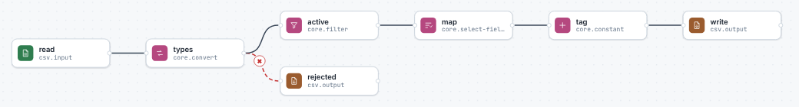

# pipelines

Example pipelines of Runnel: reading, converting, filtering and writing records. Open a
pipeline from this list, or run it with `runnel run` (paths are relative to this folder).

## Pipelines

| Pipeline | What it shows |
|---|---|
| [numbers](pipelines/numbers.pipeline.yaml) | generates records, copies them to two branches and merges them |
| [orders](pipelines/orders.pipeline.yaml) | reads a CSV file in German format and keeps large orders |
| [customers](pipelines/customers.pipeline.yaml) | prepares customers for a CRM import; invalid ones go to an error link |
| [segments](pipelines/segments.pipeline.yaml) | splits customers by revenue with `core.switch` |
| [routing](pipelines/routing.pipeline.yaml) | branches the usual way: errors to their own file, `core.switch` with a default, the same fields in every branch, joined again and sorted, copied to a file and to counts per route |
| [daily](pipelines/daily.pipeline.yaml) | groups orders by day and sorts them |
| [xml-orders](pipelines/xml-orders.pipeline.yaml) | reads orders from an XML export with a namespace (attributes, nested elements, an error link for an amount that is no number) and writes them to a CSV file and to XML in another structure |
| [excel-orders](pipelines/excel-orders.pipeline.yaml) | reads a table below a title from an Excel workbook (a cell with `#N/A` goes to an error link) and writes the orders to a CSV file and a new workbook |

The workflow [import](workflows/import.workflow.yaml) runs `customers` and evaluates its counts.



## Try it

```
runnel run pipelines/orders.pipeline.yaml
runnel run -v workflows/import.workflow.yaml
```

More about pipelines: [Runnel on GitHub](https://github.com/runnelhq/runnel)
